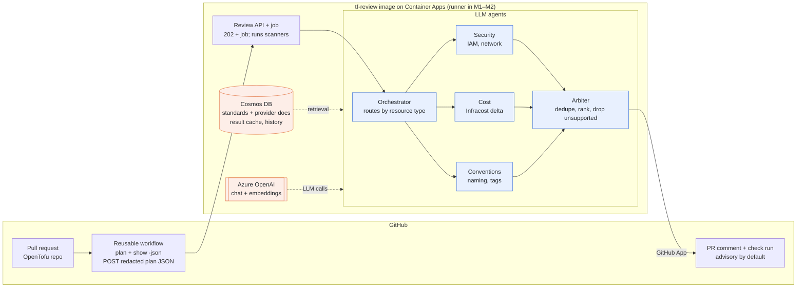
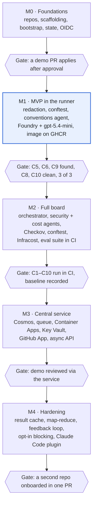

# TF PR Review Board — Plan v1

Nov 1, 2026 · @Drazsdik Gergő

## Summary

Build a multi-agent, RAG-backed review board that comments on OpenTofu (later also Terraform) pull requests, reusable by any repo through one reusable GitHub workflow, at roughly $5–30/month on Azure. Deterministic tools find issues; LLM agents explain them, rank them and tie them to the team's own standards. One container image runs the whole review: in the GitHub runner during M1–M2, in Azure Container Apps from M3.

Status: v1, every decision taken (see the Decision log); M0's to M3's gates have passed, M4 is underway, and gpt-6.1-sol reviews since 2026-11-05. This document now lives in `tf-review/docs/plan.md` and is maintained there.

**Goals**

- Learn and showcase multi-agent orchestration, RAG and evals on a realistic DevOps problem
- A reviewer any TF repo can adopt with a few lines of workflow YAML plus a config file
- A demo template repo that shows the full setup: review, deployment, agent instructions, guardrails
- A path to production use: advisory first, blocking only on deterministic findings

**Non-goals for v1**

- Auto-fixing or auto-applying anything
- Blocking merges on an LLM opinion alone
- CI systems other than GitHub Actions, clouds other than Azure for the reviewer's own hosting
- Multi-tenant SaaS (one owner, many repos)

## Prerequisites: install before M0

Installed and verified on 2026-11-01 (setup doc step 41): OpenTofu 1.13.2, conftest 0.71.1, OPA 1.22.0, Checkov 3.4.0, Infracost CLI 2.18.3, TFLint 0.65.0, tofu-ls 0.5.3. Every install follows `~/AGENTS.md` (vscan, checksum or signature, setup-doc step, tools page, `update-sources`).

| Tool | Used for | Install | Needed from |
| --- | --- | --- | --- |
| OpenTofu (`tofu`) | Plan and apply in every repo, the bootstrap | Standalone zip, cosign verified (Fedora ships 1.11.5); repos pin `required_version = "~> 1.13"` | M0 |
| conftest | Runs the `tf-standards` Rego against plan JSON, and their unit tests with `conftest verify` (same bundled OPA that enforces them) | Release binary, SLSA attestation | M1 |
| OPA (`opa`) | `opa fmt` and `opa check` for the Rego only | Release binary, release attestation | M1 |
| Checkov | Security scanner on plan JSON (D10) | `uv tool install checkov` | M2 |
| Infracost CLI v2 | Cost of each plan with `infracost scan` on plans rebuilt from the redacted one (D31); JSON output for the cost agent | Release binary from `infracost/cli`, verified; plugins pinned by checksum in `INFRACOST_CLI_PLUGIN_DIR`, which also stops the CLI fetching them | M2 |
| TFLint + azurerm ruleset | Provider-aware lint in the pre-commit hook | Release binary, SLSA attestation; ruleset fetched by `tflint --init` | M0, optional |
| tofu-ls | OpenTofu language server for Neovim and the `dg-lsp` plugin Source build at a pinned tag (`go mod download` + `go build`, because `go install` rejects its `replace` directive), checked against Go's checksum database | Optional |

Already installed and used as-is: `just`, `gh`, `lefthook`, `pass`, `az`, .NET SDK 11 (RC3 until GA) with TUnit templates, `podman`, `actionlint`, `pinact`, `yamllint`/`yamlfmt`, `shellcheck`, `hadolint`, `gitleaks`, `cosign`/`syft`/`grype`, `jq`/`yq`, `ijhttp`, Claude Code. Terraform stays installed for the D1 Terraform input in M2.

**Accounts and one-off setup**

- [x] Convert the Azure trial to Pay-As-You-Go, then check Azure OpenAI quota in Germany West Central
- [x] Delete the resource group the Foundry portal auto-created in Sweden Central
- [x] Get Data Zone Standard quota for gpt-6.1-sol and gpt-6-luna: granted with Tier 1, 100K TPM each, seen 2026-11-05; this doesn't block M2, which can start on gpt-5.4-mini. A request on 2026-11-01 was declined for lack of resources. The same day Microsoft emailed that the subscription moved to Tier 1, which can take 3–4 days to activate, and Microsoft's Tier 1 table lists 100K TPM for both models. Re-check from 2026-11-05. If the decline was about regional capacity rather than the tier, Tier 1 may not change it. Available today: gpt-5.4-mini, Mistral-Large-3 and text-embedding-3-small
- [ ] Before gpt-5.4-mini retires (2027-09-21): move to a newer small model through the eval suite
- [ ] After .NET 11 GA (scheduled 2026-11-10): install the GA SDK through `update-sources`, pin `global.json` to `11.0.100` without `allowPrerelease`, and re-pin the base image digest
- [ ] After a conftest release that fixes the go1.27.1, x/net and go-jose findings (v0.71.1 and `main` don't, checked 2026-11-01): go back to the release binary in the `Containerfile`, which also ends the difference described under "Policy tests pass but enforcement differs"
- [ ] By 2027-02-01, or at any Infracost update: review the `.grype.yaml` exception for `infracost-parser-terraform-plan`, and remove it once a plugin version ships go-jose 4.1.6 or later
- [ ] After a CSharpier release that parses C# 15 (1.3.0 fails on `union`): add it back to the prerequisites and decide where it runs; until then `dotnet format` is the only C# formatter
- [x] Infracost v2: create a personal access token, store it as `pass insert tf-review/infracost/cli-token`, clear any cached `infracost auth login` session
- [x] M3: create the GitHub App and store its private key as `pass insert -m tf-review/github-app/private-key`

## Decision log

All 49 decisions are settled as of 2026-11-02; D19–D29 came from the M1 design council, D31–D34 from M2's spike, D35–D36 from building its orchestrator and arbiter, D37–D45 from planning M3, D46 from applying its infrastructure, D47 from designing the worker, D48 from the first load on the service, and D49 from the retrieval evals. Changing one means editing its row and the sections it affects in the same commit.

| # | Decision | Choice | Why |
| --- | --- | --- | --- |
| D1 | IaC tool | OpenTofu 1.13 first; Terraform via a `tool` workflow input in M2 | Native state encryption; Terraform support doubles the test matrix, so it waits |
| D2 | Agent runtime | C# 15 on .NET 11, Microsoft Agent Framework, `IChatClient` from Microsoft.Extensions.AI over the OpenAI SDK's `OpenAIClient` | Strongest stack; the provider stays swappable; unions and closed hierarchies fit findings and agent outcomes; support should end about when .NET 10's does (November 2028); Agent Framework dropped `Azure.AI.OpenAI` in 1.21 |
| D3 | Where the review runs | One container image: the workflow runs it in M1–M2, Container Apps runs it from M3 | Identical binaries and tool versions locally, in CI and in Azure |
| D4 | LLM | Azure OpenAI in Foundry, Data Zone Standard (EU): gpt-6.1-sol `2026-09-29` for every role from 2026-11-05, at low reasoning effort, replacing gpt-5.4-mini `2026-03-17` (whose default of none failed valid names on the evals), which stays deployed as the fallback; gpt-6-luna `2026-09-22` was compared and not adopted; text-embedding-3-small `1` from M3; versions pinned and per-agent models only once an eval shows a split that helps | gpt-5.4-mini is the only OpenAI chat model with quota (checked 2026-11-01); gpt-6.1-sol is reportedly cheaper than gpt-5.4 and gpt-5.5 and retires later; Luna must beat mini on the evals, not just on price; EU processing from day one |
| D5 | Retrieval | Metadata filter plus whole docs in M1–M2; Cosmos DB free tier with vectors in M3. A team's rules stay filtered, and reference material is ranked by hybrid search, which gave 13 of 15 agents something relevant against 9 for filtering alone (`docs/evals/retrieval.md`) | The baseline shows whether vectors actually help |
| D6 | Repo visibility | Public | Free Actions minutes and environment approvals; portfolio value |
| D7 | Repos | `tf-review`, `tf-review-demo`, `tf-standards` (created 2026-11-01) | Standards have their own owner and lifecycle in production |
| D8 | Azure region | Germany West Central for all resources | Has every service; model quota is pooled per subscription anyway |
| D9 | Gate mode | Advisory; opt-in blocking only on deterministic high findings | No merge is ever blocked by an LLM opinion alone |
| D10 | Scanners | Checkov, conftest (tf-standards Rego), Infracost CLI v2, all inside the review image | Trivy was compromised in March 2026 (CVE-2026-33634); versions pinned in one place |
| D11 | PR identity | `GITHUB_TOKEN` in M1–M2, GitHub App from M3 | The App is only needed once a service posts |
| D12 | State bootstrap | OpenTofu with local state, then `tofu init -migrate-state` | Everything stays in code |
| D13 | Subscriptions | One Pay-As-You-Go subscription, a resource group per project | Cosmos free tier is one account per subscription |
| D14 | License | Apache-2.0 | Patent grant if companies adopt it |
| D15 | Budget | €30/month, alerts at 50/80/100% | Catches runaway token spend early |
| D16 | Hosting | Azure Container Apps, consumption-only: API app + event-driven job, scale to zero | An App Service B1 plan costs $12.41/month idle (priced with Infracost on 2026-11-01) and has no job model |
| D17 | Image registry | GitHub Container Registry, public image, cosign-signed, consumers pin by digest | Free for public images; no registry bill in Azure |
| D18 | Infracost | CLI v2 with checksum-pinned plugins; token in pass locally, in Key Vault for the service | v0.10 is being retired; plugins are unsigned, so they're pinned |
| D19 | M1 scanner and model role | conftest moves to M1 and its results are the conventions agent's input; the gate adds a case Rego misses | Matches the agent design, so the baseline carries into M2; without the extra case the gate wouldn't test the LLM |
| D20 | M1 arbiter | Rule-based behind `IArbiter` (severity sort, verdict); LLM arbiter in M2, limited by D36 | With one agent there's nothing to arbitrate, and it halves the LLM calls |
| D21 | LLM credentials | Two jobs: the plan job runs PR code and uploads only a redacted plan; the review job runs no PR code and uses its own identity, federated on `environment:review` | `tofu plan` runs code a PR controls, which could otherwise mint the LLM credentials; this doesn't stop someone who can edit the workflow |
| D22 | Evidence pointers | Address-keyed: `/resource_changes/<escaped address>/...`, composed by code and checked against `resource_address` | Array indexes shift with slices and no-op drops, and would break M4's cached findings |
| D23 | Image pinning | Two tags: `image-v*` builds and signs, a PR pins the digest on `main`, `v*` publishes the workflow; dev images are a separate signed package passed through an `image` input | A tag's workflow can't contain its own image digest; `main` always holds a valid one |
| D24 | Reviewer infra | `tf-review` joins bootstrap's `repos` map, CI applies `infra/` behind `prod` approval, and bootstrap grants the LLM role at resource group scope | The apply identity's Contributor can't assign roles; a new repo stays one map entry |
| D25 | Redaction policy | Tofu's sensitive marks plus an attribute-name denylist, with marked values swept wherever else they appear; GUIDs in changes are replaced too, but not in addresses; malformed input refuses the review; other values pass | The model keeps its context; unmarked secrets under ordinary names remain a known risk. Resource IDs hold the subscription ID, which D30 keeps out of public logs, and the plan artifact and comments are public too; addresses have to stay unique |
| D26 | Corpus metadata | `topics` enum in corpus frontmatter; agents declare the topics they retrieve | The schema can't express "naming, tags" today, so POL-001 would reach the conventions agent |
| D27 | Config source | `.tf-review.yml` is read from the PR's base commit | A PR can't disable its own review or swap the standards corpus; config changes apply after merge |
| D28 | Release pipeline | The full pipeline from M1; Grype fails only on high findings that have a fix, with exceptions in `.grype.yaml` limited to one finding on one file | Unpatched base image issues can't stall a release. The first exception is go-jose in Infracost's closed-source plan parser, which we can't patch |
| D29 | M1 gate | 3 of 3 fixture runs per case on C5, C6, C8, C9 and C10, plus one real PR | One run can pass by luck; 3 of 3 is still weak evidence, so M2's baseline replaces it |
| D30 | Azure IDs in CI | Subscription, tenant and client IDs are Actions secrets; state and Foundry names stay variables | They aren't credentials, but Actions logs on public repos are public, and only secrets are masked there; state names are committed anyway, and masking the rest would add little. Projects planned in CI can't use the `azurerm_client_config` data source, because its printed ID holds these in base64, out of the masking's reach |
| D31 | Cost delta | Two `infracost scan` runs, over "before" and "after" plans rebuilt from the redacted plan's `resource_changes`; code computes the delta per resource | No main-branch baseline to store or let go stale, and no raw plan in the review job. `infracost diff` matches by file path, so it reports differently named files as one project removed and one added, and only its total is useful |
| D32 | Scanner input | Checkov and Infracost read a plan rebuilt from the redacted one. Infracost reporting no resources for a plan that has some counts as failed, and every Checkov scan includes a canary that always fails, whose absence counts as failed | Both exit 0 with an empty result on a plan they don't recognize, which looks exactly like a clean scan, and Checkov also needs `terraform_version`. Zero results is legitimate for Checkov on types with no checks, so only a canary can prove it ran. Scanners never see the raw plan, so a value marked sensitive can't be priced or checked |
| D33 | C4 and C7 fixtures | Hand-built in `tests/fixtures/cases`, with no seeded PR | Both need an existing resource that a plan updates or replaces, and keeping a VM or database deployed for it would cost money. The other cases remain real seeded PRs |
| D34 | Checkov findings | Only an allowlist of checks becomes findings, each with a severity set in code | One storage account failed 11 checks in the spike, and checks that look for related resources can't pass without `configuration`, so reporting everything would bury C1–C3 and fail C8 and C10 |
| D35 | Orchestrator | Code routes, by each agent's retrieved standards; an LLM call only orders the changes and explains the riskiest, inside rule-based tiers (deletes and replacements, access, network, everything else), with those rules as its fallback | `applies_to` and topics already pick what each agent sees, so an LLM router would either duplicate that or risk silently skipping a review. An order is safe to get wrong, and a model can't bury a destructive change |
| D36 | LLM arbiter limits | It proposes merges and an order within a severity, and can't remove a finding; code refuses anything else: adding a finding, merging across resources, merging a model finding into a deterministic one, or ranking a lower severity above a higher one. Invalid output keeps the rule-based result | Plan text can steer a model, and a merged row counts as deterministic, so an unguarded merge could make a model's opinion blocking. It could drop model findings at first, and on a live run it dropped C9's correct one |
| D37 | M3 scope | Everything as planned: the service, Cosmos and vectors together | Learning and showcasing the stack matters more here than the cheapest way to run it. The corpus grows to make retrieval a real problem (D41) |
| D38 | Runner mode | The service replaces the in-runner review. The plan job stays, because it holds the cloud credentials; the review job only submits | One path to maintain, and the LLM identity and Infracost token leave every repo. An outage stops all reviews, which D39 makes visible. Callers pinned to older tags keep working until their identities go |
| D39 | Service outage | The workflow posts "not reviewed" with its own token | The same honest answer as every other failure, so an older result can't stand for this commit. It needs nothing extra in each repo, and a re-run reviews it after recovery |
| D40 | Onboarding | A repo is allowed when it's in bootstrap's `repos` map, which deploys the allowlist to the service. Installing the GitHub App is a separate step | One reviewed line per repo, which M4's gate expects. App installation alone can't spend the LLM budget |
| D41 | Corpus growth | Import Azure Policy built-ins (MIT), Cloud Adoption Framework (CC-BY-4.0) and azurerm provider docs by version (MPL-2.0), generated by a script at a pinned source commit, with source and licence per doc. Not CIS: its benchmark PDF forbids third-party hosting, and `tf-standards` is public | With 7 short docs, filtering already returns everything relevant, so vectors have nothing to improve. Provider docs are the plan's original case for them |
| D42 | Reference docs | A new `reference` doc type: imports are retrieved to inform findings and can't create one by being broken. Only a team's own accepted docs can. A team promotes an imported rule by writing an ADR or policy | "Accepted" means a team decided it. Hundreds of imported rules as standards would flood every PR and fail the clean eval cases |
| D43 | Reference storage | Imported docs live only in Cosmos, as documents with their vectors. `corpus/sources.yml` in `tf-review` pins each source repo and commit, and the azurerm versions to index. No copy of them in any git repo | Azure Policy alone is 5,179 files and azurerm over 1,400 per version, and a review refuses a standards download over 5,000 entries or 20 MB, so they can't go in `tf-standards`. Everything in Cosmos can be rebuilt from the pins, so a second copy in git would add no safety |
| D44 | Refreshing the corpus | Changing `corpus/sources.yml` is the only trigger: on a PR a dry run reports what would change, with no credentials, and on merge indexing runs. A team's rules aren't indexed, because reviews read them at their pinned commit (D42) | One path, in the repo that owns the corpus's use. Sources change slowly, so a person choosing a commit is enough, and a pin change is a reviewable, revertible PR |
| D45 | API trust | The API accepts a GitHub OIDC token only with this audience, `event_name` `pull_request`, `environment` `review`, a `repository_id` on the allowlist, and a `job_workflow_ref` naming `tf-review`'s `tf-review.yml` at a commit on a list of released commits. It takes the PR number from `ref`, never from the request | Real tokens showed `environment` refuses the plan job, which runs PR code, and `job_workflow_ref` refuses a job a PR adds to its own workflow. GitHub resolves a fork's commit through its parent repo, so a commit SHA alone in `tf-review`'s name proves nothing, hence the list of released commits |
| D46 | azapi where azurerm reads secrets | The Cosmos account, its vector container, the Container App and the job use the azapi provider. Other resources stay in azurerm. azurerm lists keys or secrets on every read of these, even when there are none, so a Reader's plan fails with a 403, and it can't declare a vector policy. The alternative was giving the plan identity, which runs PR code, the right to list them. With azapi it stays a Reader, and no keys reach the state. A new resource type gets a real plan with state before relying on it, because the first plan of a resource can't show this |
| D47 | Sealed scanners | Scanners get only the environment they need, and conftest runs without `http.send`, `net.lookup_ip_addr`, `opa.runtime` or its own file readers. A policy using one doesn't compile, which reports a failed scan. The App's key is read from Key Vault into the worker's memory when posting, never put in its environment | A config chooses the standards repo, and its Rego runs in the review. A test showed Rego reading an environment variable and calling out over the network. In the service that would reach the managed identity's endpoint, so one repo's config could get at Key Vault and every other repo's reviews |
| D48 | Review plans take no lock | The reusable workflow's plan runs with `-lock=false`. A repo's apply still locks | PRs planning at once race on the state blob: one can see another's lease before its lock details are written, and the azurerm backend fails at once with `terraformlockid was empty`, whatever `-lock-timeout` says. A review plan writes nothing and is never applied. The cost is that a plan during an apply may read the state from before it, which is advisory, and the next push reviews it again. Queueing them instead isn't possible, because GitHub's concurrency groups keep only one waiting run |
| D49 | Re-ranking references | Search returns 15 candidates of each kind, a model picks up to 6 by title, heading and opening, and code fills the budget in that order. Its input is the slice's types, actions, the attributes that are set and short values, never names, tags or free text. A failed call keeps the search's order | The retrieval evals found the relevant docs ranking just below the budget's cut, and re-ranking took hybrid from 27% to 34–36% of them on the real index. A code-built query in words, a model-written query and a cleaned index each did no better. A PR can at worst steer which background an agent sees, which can't create a finding (D42) |
| D50 | References per finding | The placement for `references: true` (`ReferencePlacement.Finding`, the default since 2026-11-05; per agent stays for the evals): agents get no references, and after the arbiter each finding citing a team standard gets its own search, from the standard's title, the resource type and the attribute name, and one model call may add one sentence to its suggestion. Code keeps it only if it cites an offered excerpt, names a term that excerpt contains, isn't the finding's own attribute or already in the suggestion, doesn't recommend Azure Policy, and the model's last field says it's the same problem | Per agent, references were about resources rather than problems, and asking agents to use them added sentences beside the point (2026-11-04). Per finding, references can't touch a finding at all, which is stronger than D42, and a review costs about half as much. The model ignored the prompt's ban on governance advice, so code enforces it |
| D51 | Policy findings answered by ID | The conventions and security agents get each policy finding with an ID and answer `policy_suggestions` by ID; `findings` holds only what the policies missed. Code attaches each suggestion to a copy of the policy finding, which keeps its title, evidence and being deterministic | Re-reporting a policy finding as a new one needed an attribute to point at, which a deletion doesn't have, and the model sometimes skipped it: held-out C28 failed 15 of 15 runs and C29 4 of 15, leaving those findings without a suggestion. By ID, a suggestion can't change what the policy found |
| D52 | Plan variables | The reusable workflow takes an optional `PLAN_VARIABLES` secret, a JSON object it passes to the plan as a variables file and deletes afterwards. Bootstrap sets it on `tf-review` from the values `infra.yml` uses (`tenant_id`, `allowed_repository_ids`) | A project with required variables can't plan otherwise, starting with `tf-review`'s own `infra/` for self-review. A secret because the tenant ID is one (D30). PR code can read it while it plans, like the plan identity, so it holds IDs, never credentials |
| D53 | Result cache | Per model call, not per resource: `StructuredCall` looks up a SHA-256 of everything the model is given (role, system prompt with its version, the user message with the slice, standards, references and policy findings, schema, deployment, call options) in the `reviews` container, in the repo's partition, before the first attempt, and stores an answer only once it parses. A hit costs no tokens and is logged with finish `cached`. Answers expire after 7 days, like the plans, because they can quote one. A store that fails or takes over 5 s is a miss | Agents review a slice in one call, so a per-resource key would mean splitting their calls and re-measuring every eval. The whole input as the key needs no list of what counts, so nothing stale can come back, and every role is covered, including the arbiter and the suggester. A re-push that changes nothing a role sees gets the same answer, which also keeps findings from flipping. The `reviews` container is already partitioned by repo and has the free throughput, where a new one would cost |
| D54 | Large plans in batches | An agent whose user message would pass 20K estimated tokens reviews its slice in batches under that, in the rules' risk order (deletes and replacements, then access, then network, then the rest), one call after another, at most 4 batches. Each batch gets only its own resources' policy findings and cost figures. What the cap or a failed batch leaves out is reported in `not_reviewed` by resource address (`resources`, an optional field), and the comment names up to 10 of them | One call over the limit used to cost the whole scope. Sequential calls keep within the 30K TPM limit, and the cap bounds a large plan at about 80K input tokens an agent. The rules' order needs no model call, so the batches don't wait for the orchestrator, and the riskiest changes are never the ones cut. A failed batch stops the rest, because the TPM limit or an outage would fail them too. The first proof (demo #44, 20 large NSGs) found two agents batching at once outran the 30K TPM deployment: 429 retries took the review to 12 of the job's 14 minutes and cut security's last batch. So the deployment went to 100K TPM, and a `TokenPacer` per review waits before each call until its prompt plus `max_tokens` (what Azure counts) fits under 90K in the last minute; it can't see another review running at once, which the 10% and the SDK's retries cover |

## Architecture



Only the arbiter talks back to GitHub, and only findings that carry evidence (a plan pointer and an accepted doc ID) survive it. The consumer workflow does the one step that needs cloud credentials, `tofu plan`; everything after it runs from the `tf-review` container image, so scanners, agents and their versions are identical on your machine, in CI and in Azure.

**Review container image** (`ghcr.io/gergodrazsdik/tf-review`)

| Component | Pinned by | Why it's in the image |
| --- | --- | --- |
| `tfreview` CLI, API and worker (.NET 11, one build) | Git tag | The review itself; the entry command decides the role |
| conftest (bundled OPA), from M1 | Built from source at the commit behind v0.71.1, with go1.27.3, x/net 0.60.0 and go-jose 4.1.6, reported as `0.71.1-patched` | Runs the `tf-standards` Rego |
| Checkov, from M2 | `tools/checkov/uv.lock`, in a virtual environment with its own Python | Security findings on the plan JSON |
| Infracost CLI v2 + terraform-plan and azure plugins, from M2 | CLI built from source at the commit behind v2.18.3 with x/net 0.60.0, reported as `2.18.3-patched`; plugins by version and checksum; `INFRACOST_CLI_PLUGIN_DIR` set in the image | Cost per resource; nothing downloads at run time |

Not in the image: OpenTofu (the plan runs in the consumer workflow, next to its credentials and state), the Azure CLI, git, and the `tf-standards` content, which is fetched at review time as a commit tarball over HTTPS, at the commit named in the base branch's `.tf-review.yml`, so a policy change never needs an image rebuild.

- Base: `mcr.microsoft.com/dotnet/aspnet:11.0-resolute` (Ubuntu 26.04), pinned by digest, with Checkov's own Python added from M2; non-root user, read-only root filesystem
- Built by `tf-review` CI on each `image-v*` tag (D23): hadolint, build, Syft SBOM, Grype scan (fails on high findings with a fix), cosign keyless signing with the workflow's OIDC identity (public Rekor entry, intended for a public repo), push by digest
- The reusable workflow references the image by digest and runs `cosign verify` against `tf-review`'s release workflow identity before any PR code runs; the identity is hardcoded per package, not an input
- Locally: `just image` builds it with podman; `just review plan.json` runs it
- Size (a few hundred MB with Python and plugins) doesn't matter: the review is asynchronous

**Request flow (from M3)**

1. Consumer workflow: `tofu plan`, `tofu show -json`, then the image's `submit` command redacts the plan and POSTs it to `/reviews` with the workflow's GitHub OIDC token; the API answers `202` with a review ID
2. The API checks the token against the onboarded repos, stores the redacted plan in Blob Storage (deleted after 7 days) and enqueues a message on a Storage queue
3. A Container Apps job, scaled by that queue, picks the message up
4. The job condenses and canonicalizes the plan, runs Checkov, conftest and Infracost, then the orchestrator, the specialist agents and the arbiter
5. The GitHub App updates the PR's sticky comment and sets the `tf-review` check run

In M1–M2 steps 1–3 collapse into the workflow's two jobs (D21): the plan job runs `tfreview redact`, and the review job runs `tfreview review` from the same image and posts with `GITHUB_TOKEN`.

## Agents and prompts

Five LLM roles by M2 (M1 has only the conventions agent, D19–D20), each a Microsoft Agent Framework agent with a versioned prompt file, structured JSON output against a flat wire schema, and its model set in config. Code maps that output to the finding contract and sets `rule`, `severity`, `agent`, `deterministic` and `evidence`: Azure's strict mode rejects parts of `finding.schema.json`, and a model must never be able to claim `deterministic: true`.

| Agent | Gets | Retrieves | Model (v1) | Returns |
| --- | --- | --- | --- | --- |
| Orchestrator | Addresses, types and actions, with no values | Nothing | gpt-5.4-mini | Risk order within code's tiers, and reasons for the riskiest. Code does the routing (D35) |
| Security | Its slice plus the Checkov and conftest results for it | Accepted policies and ADRs whose `applies_to` matches the slice | Stronger model once granted; gpt-5.4-mini until then | Findings |
| Cost | Its slice plus Infracost per-resource cost and delta | ADRs tagged as cost guidance | gpt-5.4-mini | Findings with monthly delta |
| Conventions | Its slice plus conftest naming and tag results | Accepted docs with its topics (`naming`, `tagging`) whose `applies_to` matches | gpt-5.4-mini | Findings |
| Arbiter (from M2; rule-based in M1) | All surviving findings, with no plan values beyond what titles quote | Nothing | Stronger model once granted; gpt-5.4-mini until then | Proposed merges, order and drops, within what code allows (D36). Code sets the verdict |

**Rules every agent run follows**

- Prompts live in `tf-review/prompts/<agent>.md` with a version header, embedded in the assembly, with each version's hash in `prompts/versions.json`; the version is logged per call and is part of the result-cache key
- Invalid JSON or a truncated answer gets one retry; after that, the agent's slice is reported as "not reviewed" instead of guessed. Refusals, content filters and service failures aren't retried by the agent, and the SDK retries 429s and 5xx itself
- A deterministic evidence check runs before the arbiter: each finding needs a plan pointer that resolves and matches its `resource_address`, and an LLM finding no scanner backs also needs a doc ID that is accepted, was retrieved for this prompt and applies to that resource type, since scanner rules such as Checkov's have no doc, and must point at an attribute the plan changes; failures are dropped and counted by reason, and never retried
- Deduplication key: resource address plus rule (doc ID or scanner rule ID); the highest severity wins and the evidence is merged
- Only deterministic high findings (Checkov, conftest) can block, and only when a repo opts in (D9); LLM-only findings never block
- Agents see only redacted plans: only the redactor reads the raw plan, and `CondensedPlan` is the only plan type the agents accept. Redaction can't catch unmarked secrets under ordinary attribute names (D25)
- Plan text is untrusted: it goes in a fenced user message with `<>&` escaped, agents have no tools, and code renders the PR comment, escaping free text, stripping URLs, mentions and the sticky marker, and building doc links from `doc_id` only
- "No findings" never means approval, and the comment says so; any failure posts "not reviewed" for that commit instead of leaving an older result standing

## Review service internals

One .NET 11 solution produces the CLI, the API and the worker from shared libraries, so the M3 move changes hosting, not logic.

```
src/
  TfReview.Core/       plan parsing, diff condensing, canonical JSON, redaction
  TfReview.Scanners/   Checkov, conftest and Infracost runners + result parsers
  TfReview.Rag/        IRetriever: FileRetriever (M1-M2), CosmosRetriever (M3)
  TfReview.Agents/     orchestrator, agents, arbiter, prompt loader
  TfReview.GitHub/     sticky comment + check run publishers (token or App)
  TfReview.Cli/        tfreview review | submit (runner, local, job)
  TfReview.Api/        POST /reviews, GET /reviews/{id} (M3)
  TfReview.Worker/     queue-driven review job (M3)
tests/                 TUnit projects; fixtures from the seeded demo cases
prompts/               versioned agent prompts
Containerfile
```

- **SDK and language**: `global.json` pins `11.0.100-rc.3.26522.148` with `allowPrerelease` until GA; C# 15 is the `net11.0` default, so no `LangVersion` override
- **C# 15 usage**: unions and `closed` records for internal models such as `Evidence` and agent outcomes; the JSON contracts don't change. `Evidence` uses `JsonUnionTypeStructuralClassifier`, because the default classifier can't tell two object cases apart. The schema generated from a union is looser than `finding.schema.json`, so findings are still validated against the contract
- **Auth**: `DefaultAzureCredential` everywhere: `az login` locally, OIDC in CI, managed identity in Azure; key auth disabled on Foundry and Cosmos
- **LLM client**: `OpenAIClient` with `BearerTokenPolicy` (scope `https://ai.azure.com/.default`) on the resource's `/openai/v1/` endpoint, exposed as `IChatClient`; no `Azure.AI.OpenAI` package. That constructor is experimental, so `OPENAI001` is suppressed for it
- **Config**: `appsettings.json` and environment for the service; `.tf-review.yml` per repo for enabled agents, thresholds, gate mode and the `tf-standards` commit, read from the PR's base commit (D27)
- **Observability**: OpenTelemetry traces and metrics to App Insights: tokens, cached tokens, latency and cost per agent call, findings per agent, evidence-check drops
- **PR output**: one sticky comment per PR (hidden marker), rewritten on each push: verdict line, monthly cost delta, a table by severity, collapsible details per resource with links to the cited `tf-standards` docs at the pinned commit
- **Check run** `tf-review`: neutral in advisory mode, failure only for opted-in blocking findings; a failed review reports itself with a link to the logs and never blocks in advisory mode

## Repositories

Three public repos under `gergodrazsdik`, developed side by side; the reviewer owns every contract the other two depend on.

| Repo | Role | Key contents |
| --- | --- | --- |
| `tf-review` | The product: reviewer service, agents, reusable workflow, its own infra, and the pins for imported docs | `src/`, `.github/workflows/tf-review.yml`, `infra/`, `bootstrap/`, `corpus/`, `tests/fixtures/`, `plugin/` |
| `tf-review-demo` | GitHub template repo for any TF project adopting the reviewer | Sample TF, `.tf-review.yml`, plan/apply workflows, `docs/adr/`, seeded bad-PR branches |
| `tf-standards` | Org standards corpus for policy enforcement and agents | ADRs, policies (Markdown + Rego side by side), design docs |

```
tf-review/
  bootstrap/          # state storage, identities, onboarding map, budget
  infra/              # Foundry (M1); Cosmos, queue, Container Apps, Key Vault (M3)
  src/                # .NET 11 solution: CLI, API, worker
  tests/              # TUnit projects; tests/fixtures: plan JSON + expected findings
  prompts/            # versioned agent prompts
  plugin/             # Claude Code plugin: conventions skill + hooks (M4)
  docs/               # plan.md, contracts/ (JSON Schemas)
  Containerfile
  .github/workflows/
    tf-review.yml     # on: workflow_call
    ci.yml            # lint, test, e2e
    release.yml       # image build, scan, sign, push on image-v* tags
    dev-image.yml     # signed tf-review-dev image, on dispatch
    infra.yml         # plan infra/ on PR, apply on main behind prod
```

**Contracts owned by `tf-review`** (versioned with tags, JSON Schema where possible)

1. Reusable workflow inputs, secrets and outputs (`working-directory`, `config-path`, `image`, `tool`; gate mode comes from the config's `gate.mode`; the Azure IDs for planning are passed as secrets, with `secrets: inherit` for same-owner repos and explicitly otherwise)
2. `.tf-review.yml` schema: enabled agents, severity thresholds, gate mode, standards source
3. Finding schema: resource address, severity, evidence (an address-keyed plan pointer, and a doc ID when no scanner backs the finding), suggestion, agent (`scanner` when no LLM agent reported it)
4. Corpus frontmatter schema: `id`, `type`, `status`, `superseded_by`, `applies_to`, `topics`, `severity`, `rego`
5. Review result schema (M1): verdict, findings, `not_reviewed` slices, evidence-check drop counts, docs left out by the token cap, and the paths comments link to

During tandem development the demo repo calls the workflow at a release candidate tag on the feature branch (`v0.0.1-rc.1`), pinned by SHA, and repins to the release tag after merge. It can't use `@feat/x`, because `pinact` needs a SHA and a version comment, and the required check is `tf-review / plan`.

**Releasing (from M3).** The image and the workflow move separately, because the service runs the image and callers pin the workflow.

| What changed | Steps |
| --- | --- |
| Only the service: the worker, the API, agents, prompts or scanners | Tag `image-v*`, and when the release passes, pin its digest in `infra/apps.tf` and apply. No caller changes. A real demo PR proves it |
| The workflow, or commands it runs from the image (`redact`, `submit`, `publish`) | The same image tag, and pin the digest in the workflow as well. Then add the merge commit to `infra/released-commits.txt` and apply, because a commit can't name itself (D45). Tag `vX.Y.Z-rc.N` at that commit and test on a draft demo PR pinned to it. If it passes, tag `vX.Y.Z` at the same commit, and repin the demo |

The list only holds commits callers may use, so one that failed its test comes off it, and so does one no caller has pinned for a while. Testing a candidate on the seed PRs needs them to merge cleanly with the demo's `main`: **GitHub runs no `pull_request` workflow for a PR that conflicts with its base**, and says nothing, so after the demo repins, merge its `main` into each seed. `just service-eval` refuses to run while one conflicts.

## Setup: repos, folders and dev workflow

All three repos sit side by side under `~/projects/tf-review-board/`; each gets a `justfile` and a `lefthook.yml`, and every secret comes from pass at run time.

**Create the repos (M0; `gh` writes, so you run them)**

```bash
mkdir -p ~/projects/tf-review-board && cd ~/projects/tf-review-board
gh repo create gergodrazsdik/tf-review --public --clone --add-readme \
  --license apache-2.0 \
  --description "Multi-agent RAG review board for OpenTofu PRs"
gh repo create gergodrazsdik/tf-review-demo --public --clone \
  --add-readme --license apache-2.0 --gitignore Terraform \
  --description "Template: OpenTofu project reviewed by tf-review"
gh repo create gergodrazsdik/tf-standards --public --clone \
  --add-readme --license apache-2.0 \
  --description "Template: ADRs and policies for tf-review"
gh repo edit gergodrazsdik/tf-review-demo --template
gh repo edit gergodrazsdik/tf-standards --template
```

`tf-review` gets its `.gitignore` from `dotnet new gitignore` plus the OpenTofu patterns (`.terraform/`, `*.tfplan`, `*.tfstate*`).

**Repo settings (each repo)**

1. Workflow token read-only by default: `gh api -X PUT repos/gergodrazsdik/<repo>/actions/permissions/workflow -f default_workflow_permissions=read`
2. Settings → Actions: require approval for workflow runs from all outside contributors
3. Settings → General: automatically delete head branches when a PR merges
4. Ruleset on `main` kept in the repo as `.github/rulesets/main.json` (PR required, squash merges only, signed commits, required check `lint`, plus `test` in `tf-review` and `plan` in `tf-review-demo`, the only repo with a plan job in M0), applied with `gh api repos/gergodrazsdik/<repo>/rulesets --input .github/rulesets/main.json`
5. `tf-review-demo` only: environment `prod` with you as required reviewer

**justfile recipes** (`just` lists them; destructive ones carry `[confirm]`). Each recipe arrives with the milestone that first needs it: M0 has `claude`, `hooks`, `lint`, `contracts`, `bootstrap-*` and `policy-test`; `test`, `plan`, `cost`, `review`, `e2e` and `secrets-sync` come with M1 and M2.

| Recipe | Repo | Does |
| --- | --- | --- |
| `just claude` | all | Starts Claude Code with the two sibling repos added and their CLAUDE.md loaded |
| `just hooks` | all | `lefthook install` |
| `just lint` | all | The checks that need no plugins, on every file, so they work in the Claude sandbox; the CI `lint` job runs the same recipe |
| `just validate` | `tf-review`, `tf-review-demo` | `tofu validate` and `tflint`, whose plugins can't start in the sandbox; the CI `lint` job runs it too |
| `just test` | `tf-review` | `dotnet build -m:1`, then `dotnet run --project <tests> --no-build` for each TUnit project; CI runs `dotnet test` |
| `just lint-dotnet` | `tf-review` | `dotnet format whitespace --folder --verify-no-changes`, then `dotnet build -m:1 --no-incremental -p:EnforceCodeStyleInBuild=true -warnaserror`; CI runs the full `dotnet format --verify-no-changes` |
| `just plan <dir>` | `tf-review`, `tf-review-demo` | `tofu init`, `plan -out`, `show -json`, then canonicalize and redact |
| `just cost <plan.json>` | `tf-review` | `infracost scan <plan.json> --json` with the token read from pass for that run only and `SSH_AUTH_SOCK` unset |
| `just review <plan.json>` | `tf-review` | Runs the reviewer console app locally on one plan |
| `just e2e` | `tf-review` | Replays recorded model responses over the committed fixtures and asserts the expected findings; offline, no Azure and no token spend, so the Claude Code Stop hook can run it |
| `just e2e-live` | `tf-review` | Runs the committed fixtures against the real model N times and asserts on the review result; manual, and the `e2e-live` workflow runs it on PRs that change the agent, its prompts or the fixtures |
| `just fixtures` | `tf-review` | Takes the redacted plan each seeded branch's review already made, replaces every GUID with zeros, and writes it to `tests/fixtures/cases/`, so no raw plan reaches a laptop and no Azure login is needed |
| `just record-scans` | `tf-review` | Saves what real Checkov and Infracost say about each eval case, so `just e2e` and CI need neither; reads the token from pass, so you run it |
| `just bootstrap-plan` / `bootstrap-apply` / `bootstrap-migrate` | `tf-review` | The bootstrap project with your `az login`; apply and migrate ask first |
| `just secrets-sync` | `tf-review` | Copies the Infracost token and the App's key from pass into Key Vault; you run it, never an agent |
| `just policy-test` | `tf-standards` | `opa fmt --fail`, `conftest verify`, frontmatter schema check |

The `claude` recipe in `tf-review` (the other repos list their own two siblings):

```just
# Start Claude Code with the demo and standards repos in reach
[group('dev')]
claude *args:
    CLAUDE_CODE_ADDITIONAL_DIRECTORIES_CLAUDE_MD=1 claude \
      --add-dir ../tf-review-demo --add-dir ../tf-standards {{args}}
```

**lefthook.yml** (pre-commit runs in parallel on staged files; pre-push runs `just test` or `just policy-test`)

| Hook | Files | Command |
| --- | --- | --- |
| tofu fmt | `*.tf` | `tofu fmt -check {staged_files}` |
| tflint | `*.tf` | `tflint --recursive` |
| yamllint | `*.yml`, `*.yaml` | `yamllint {staged_files}` |
| actionlint, pinact | `.github/workflows/*` | `actionlint` and `pinact run --check` |
| shellcheck | `*.sh` | `shellcheck {staged_files}` |
| hadolint | `Containerfile` | `hadolint {staged_files}` |
| dotnet format | `*.cs` | `dotnet format whitespace --folder --verify-no-changes --include {staged_files}` |
| opa fmt | `*.rego` | `opa fmt --fail {staged_files}` |
| gitleaks | everything staged | `gitleaks git --pre-commit --staged` |

**Secrets in pass** (never in a repo, `.env` file or shell config)

| pass entry | Used locally by | Reaches CI or Azure via |
| --- | --- | --- |
| `tf-review/infracost/cli-token` | `just cost` runs, exported as `INFRACOST_CLI_AUTHENTICATION_TOKEN` | M2: `just secrets-sync` → Actions secret per onboarded repo, until M3 moved it to Key Vault; M3: Key Vault, repo secrets removed |
| `tf-review/github/bootstrap-token` | `just bootstrap-*` (github provider: Actions secrets and variables, environments; the fine-grained token needs Secrets read and write on every onboarded repo) | Never leaves the machine |
| `tf-review/github-app/private-key` (M3) | Local runs of the review service | `just secrets-sync` → Key Vault |

Azure needs no keys at all: Azure OpenAI and Cosmos DB use Entra ID (`az login` locally, OIDC in CI, managed identity in Azure) with local key auth disabled on both. Recipes read pass entries only at run time, so pinentry may prompt.

## Infrastructure and state

One storage account holds every repo's state, created once by a bootstrap project run from your laptop; everything after that deploys through CI with OIDC and no stored secrets.

**Bootstrap (`tf-review/bootstrap`)**

1. Run once with local state through the bootstrap recipes (OpenTofu, your az login): resource group, storage account (versioning, soft delete, `CanNotDelete` lock), state containers, managed identities, federated credentials, role assignments.
2. Add the `azurerm` backend (`use_oidc`, `use_azuread_auth`) and run `init -migrate-state` so bootstrap's own state moves into the account.
3. Onboard repos through a `repos` map: each entry creates a container, plan, apply and review identities, and sets the repo's Actions secrets and variables via the `github` provider.
4. Later, give bootstrap its own CI identity so onboarding becomes a reviewed PR.

**Identities per repo**

| Identity | Federated subject | Rights |
| --- | --- | --- |
| Plan | `repo:<owner>@<owner-id>/<repo>@<repo-id>:pull_request` | Reader on the target scope, Blob Data Contributor on its own state container |
| Apply | `repo:<owner>@<owner-id>/<repo>@<repo-id>:environment:prod` | Write on the target scope, gated by environment approval |
| Evals (`tf-review` only, from M3) | `repo:<owner>@<owner-id>/<repo>@<repo-id>:environment:review` | Cognitive Services OpenAI User on the Foundry resource group, and from M3 reading the `tfreview` database for the live evals with references (D21, D24). Until M3 each repo had one for its review job |
| Reviewer submit (M3) | No Azure identity: the API checks the GitHub OIDC token itself (D45) | Call the review API only |
| Service (M3) | None: a managed identity on the service's container apps | LLM, queue, blobs, reading secrets and, from `infra/`, Cosmos, all in `tf-review`'s resource group |
| Index (M3) | `repo:<owner>@<owner-id>/tf-review@<repo-id>:environment:corpus`, which only `main` can use, after your approval | Embeddings and writing the `tfreview` database, both from bootstrap, because `infra/`'s plan identity can't read the state resource group (D44) |

**Reviewer infrastructure** (`tf-review/infra`; Foundry from M1, the rest from M3)

Nothing in the service stays running between PRs (D16). The API scales to zero and starts when a review is submitted, and the review job exists only while a message is on the queue. So compute costs nothing when idle, and what persists is storage: Cosmos, the Storage account, Key Vault and logs. The price is a cold start of some seconds on the first request, so `tfreview submit` retries with a timeout before it reports the service as unreachable (D39).

The grown corpus raises Cosmos storage and request units and takes one round of embeddings, and that increase is accepted, with exact numbers to come from part 1 of M3.

| Resource | Purpose | Tier | From |
| --- | --- | --- | --- |
| Azure OpenAI in Foundry | gpt-5.4-mini Data Zone deployment; later gpt-6.1-sol and `text-embedding-3-small`; a project so the new portal can open the account, which the review itself doesn't use | Pay-as-you-go, key auth disabled | M1 |
| Role assignments (in bootstrap, D24) | Cognitive Services OpenAI User at resource group scope for each onboarded repo's review identity (M1–M2) and the service identity (M3), which also gets Storage Queue and Blob Data Contributor and Key Vault Secrets User there | — | M1 |
| Cosmos DB for NoSQL | Vectors, review history, result cache, feedback | Free tier (1,000 RU/s, 25 GB), key auth disabled | M3 |
| Storage account | Review queue and redacted plans (lifecycle rule deletes after 7 days) | Standard LRS | M3 |
| Container Apps | Review API (scale to zero) and the queue-scaled review job | Consumption-only environment, public ingress | M3 |
| Key Vault | GitHub App private key, Infracost token | Standard, RBAC | M3 |
| App Insights + Log Analytics | Traces, tokens, cache hit rate | Daily ingestion cap | M3 |

All resources live in Germany West Central (D8). Model deployments use Data Zone Standard (EU) from day one (D4); gpt-5.4-mini has 200K TPM there and no Global Standard quota (checked 2026-11-01).

## RAG, context and caching

Retrieval filters on metadata first and uses vectors second; every prompt is cut to a diff and a fixed token budget before any model sees it.

**Corpus**

- Global scope: `tf-standards` (ADRs, policies with their Rego, design docs), plus reference docs from M3: Azure Policy built-ins, Cloud Adoption Framework and provider docs keyed by `provider@version` from each repo's lock file. Reference docs inform findings and can't create one (D42)
- Repo scope: each TF repo's own `docs/adr/`, indexed by that repo's CI with `scope: repo`
- Only `status: accepted` docs are retrievable; superseded ones are excluded, so agents never cite a retired decision. CIS benchmarks stay out, because their terms don't allow hosting them in a public repo (D41)

**Refreshing the corpus (D43, D44)**

| | A team's rules (`tf-standards`) | Reference docs |
| --- | --- | --- |
| Where it comes from | Written by the team | Azure Policy, Cloud Adoption Framework and azurerm docs, pulled from their GitHub repos at the commits pinned in `corpus/sources.yml` |
| Where it's kept | Git | Cosmos only, as documents with their vectors. Rebuildable from the pins |
| How it changes | A normal PR in `tf-standards` | A PR in `tf-review` changing a pin |
| What a review reads | The rules, fetched as a tarball at the config's pinned commit, as today | Chunks from Cosmos, by filter and vector search |

On a PR changing `corpus/sources.yml`, a dry run needs no Azure credentials: it pulls the sources at both commits and reports which docs would be added, changed and removed, how many chunks that makes, what embedding them should cost, and a link to the upstream comparison. That report is how a pin change gets reviewed, because the upstream text itself isn't in the diff.

On merge, indexing:

1. Pulls each source at its pinned commit and turns it into docs with `source`, `source_commit` and `license`
2. Chunks by heading, and hashes each chunk together with the embedding model and chunker version
3. Embeds only new or changed chunks, and writes them as a new `corpus_version`
4. Switches retrieval to that version only once it's complete, so a failed run leaves the old one in use and a review never sees a half-built index
5. Deletes versions no longer in use

Changing the embedding model or the chunker changes every hash, so the next run re-embeds everything without a special path. A by-hand run rebuilds from the pins, for recovering from a bad state. Reverting a pin change rolls back the same way.

- **Credentials:** only the indexing job holds them: an identity with embedding and Cosmos write rights, federated on an environment on `tf-review`'s `main`. The dry run and PRs can't reach it.
- **Provider versions:** `corpus/sources.yml` lists the azurerm versions to index, and each chunk is filtered by version. A plan's JSON doesn't name the provider version, so the review reads it from the lock file at the base commit. A version that isn't indexed gets no provider docs, and the result says so rather than using another version's.
- **Rules and references can differ in age:** a repo's rules are pinned by commit, and reference docs come from whatever's indexed. That's fine, because they can't create findings (D42), and each result records the `corpus_version` it used.
- **Upstream text is untrusted:** it goes in unread, apart from the dry run's report, so reference chunks stay in their own fence in the prompt and can't create findings. The risk is limited to a bad suggestion from text in Microsoft's or HashiCorp's own repos at a pinned commit.
- **Licences:** nothing gets republished in a public repo, though text shown in a comment or a suggestion derived from it still needs attribution, so each chunk keeps its source and licence.

**Retrieval per agent**

1. Filter by the agent's `topics`, `applies_to` (resource types in the agent's slice), `status` and `scope`
2. M1–M2: include whole matching docs; M3: vector or hybrid ranking within the filtered set
3. Stop at a per-agent token cap, deduplicated by doc ID

**Context budget**

- Send `resource_changes` only, drop `no-op` entries, keep only attributes that differ between `before` and `after`
- Each agent gets only its routed resources plus their scanner findings
- Above a size threshold, batch resources across calls (map-reduce) and review deletes, replacements, IAM and network changes first; the comment states what was skipped (D54)

**Caching**

- Prompt layout, most static first: system message with the common preamble, agent instructions and retrieved chunks; user message with scanner findings and the condensed diff, which keeps untrusted text out of the instructions
- The specialist agents run in parallel after the orchestrator; prefixes are shared per agent across re-pushes, because slices differ between agents
- Canonical JSON, deterministic redaction placeholders, chunks sorted by doc ID, no timestamps or IDs in the prefix
- Result cache in Cosmos keyed on a hash of a model call's whole input, which holds the resource changes, agent, prompt version and corpus version (D53); a role whose input didn't change on a re-push isn't called
- Log `cached_tokens` per agent call to App Insights

## CI/CD and GitHub

A consumer repo adopts the reviewer with one `uses:` line; plan runs on every PR, apply runs on merge behind an environment approval, and no secret is stored anywhere.

**Reusable workflow `tf-review.yml` (PR path)**

Both jobs skip fork PRs inside the reusable workflow, so the guard can't be lost in a caller. The caller grants `contents: read`, `id-token: write` and `pull-requests: write`; only the review job uses the last one. A `concurrency` group per PR cancels superseded reviews.

Plan job (runs PR code, holds the plan identity):

1. Pull the review image by digest and `cosign verify` it, before any PR code runs
2. Azure auth via OIDC with the repo's plan identity
3. `setup-opentofu` at the version in `.tf-review.yml` (or Terraform per D1); provider cache keyed on `.terraform.lock.hcl`; `init -lockfile=readonly`
4. `plan -out`, then `show -json`
5. `tfreview redact plan.json`, upload only the redacted plan (1-day retention), and delete the raw JSON

Review job (no PR code, `review` environment, holds the review identity; not a required check, with `timeout-minutes` set):

1. Download the redacted plan and treat it as untrusted; read `.tf-review.yml` from the base commit
2. M1–M2: run `tfreview review` from the image (conftest, agents; Checkov and Infracost from M2) with a GitHub OIDC token mounted for `DefaultAzureCredential`, since the image has no `az`
3. `tfreview publish` posts the sticky comment and the step summary with `GITHUB_TOKEN`, including "not reviewed" when anything failed
4. M3: run `tfreview submit` instead; the API answers `202`, and the GitHub App posts the comment and the check run

**Apply path (consumer workflow)**

- Trigger on merge to `main`; job uses environment `prod` with you as required reviewer
- Re-plan and apply, or apply the reviewed plan file if state is unchanged (Terraform refuses a stale plan)
- `concurrency` group per state key, `cancel-in-progress: false`

**Repo settings (public repos)**

- Third-party actions pinned to full commit SHAs with `pinact`; a `lint` job runs `just lint` (which includes `actionlint`) and, where a repo has OpenTofu code, `just validate`
- Require approval for workflow runs from outside collaborators; never `pull_request_target`
- No raw plan files as artifacts or in PR comments; the only plan artifact is the redacted one with 1-day retention (D21); mark sensitive variables `sensitive` so logs stay clean
- Rulesets from `.github/rulesets/main.json` (see Setup); the review check stays advisory until M4
- `tf-review-demo` and `tf-standards` are template repositories
- Repos are public, so other repos call `tf-review`'s reusable workflow without extra access settings
- Infracost: in M2 the token reaches each onboarded repo as the `INFRACOST_CLI_AUTHENTICATION_TOKEN` secret via `just secrets-sync`; from M3 only the service holds it (Key Vault) and the repo secrets are removed. Plugins are baked into the image, so nothing downloads at run time

## Milestones



M1 is deliberately thin: one agent and one Azure resource (Foundry with gpt-5.4-mini), so the first real PR comment lands early and every later milestone has an eval baseline to beat. A milestone is done when its gate passes on a real PR, not when its tasks are ticked.

**M0 · Foundations** (done; gate passed 2026-11-01)

- [x] Prerequisite tools installed and verified (setup doc step 41)
- [x] Three repos created; demo and standards marked as templates
- [x] Scaffold all three repos: justfile, lefthook, CLAUDE.md, `.claude/` settings, lint workflow, ruleset JSON
- [x] `tf-review/docs/contracts/`: JSON Schemas for `.tf-review.yml`, findings, corpus frontmatter
- [x] `tf-standards`: ADR-001 naming, ADR-002 required tags, POL-001 storage, with Rego and `conftest verify` tests
- [x] Bootstrap: state storage, identities, GitHub variables and `prod` environment, budget; apply, then migrate state
- [x] Rulesets applied; fork-PR approval set in each repo
- [x] Gate: a demo PR plans, comments, and applies after approval (`tf-review-demo` PR #2, 2026-11-01)

**M1 · MVP in the runner** (gate passed 2026-11-01)

Work runs in this order, so unknowns surface first and a real comment lands before the agent exists. Steps marked **you** can only be run by you.

*1. Prove the unknowns*

- [x] **You:** check the `Microsoft.CognitiveServices` provider registration, the gpt-5.4-mini model version, and that the bootstrap token reaches `tf-review` (2026-11-01)
- [x] Bootstrap PR: `tf-review` map entry, review identity and `review` environment per repo, LLM role at resource group scope, endpoint and deployment variables, deployer data access to repo state containers. **You:** `bootstrap-plan`, `bootstrap-apply` (2026-11-01)
- [x] `infra/` v0 and `infra.yml`: Foundry resource (key auth off), gpt-5.4-mini `2026-03-17` Data Zone deployment at 30K TPM, which limits how fast a runaway loop can spend but isn't a budget. **You:** approve `prod` (2026-11-01)
- [x] Live smoke test (`llm-smoke.yml`, 2026-11-01): a real call with the flat strict schema through the OpenAI SDK, `IChatClient` and Agent Framework, from a non-root, read-only container with a federated token file, on `pull_request` under the `review` environment. All three work. The agent should use the hand-written wire schema it proved, or re-run this against a generated one; Agent Framework's response doesn't surface the finish reason directly, so the truncation retry needs another route to it

*2. Solution and contracts*

- [x] Solution skeleton: `global.json`, `.slnx` written by hand, central packages, `UseArtifactsOutput`; projects Core, Scanners, Rag, Agents, GitHub and Cli, with test projects added alongside the code they test; `just test`, `just lint-dotnet`, a required CI `test` job running the full `dotnet test` and `dotnet format`
- [x] Contract PRs: address-keyed pointers and the `scanner` agent value; `topics` in corpus frontmatter, in both repos and on every existing doc; review result schema; config schema text and defaults for M1, where only `conventions` exists; `scripts/check_contract_cases.py` proves the schemas reject what they should

*3. Walking skeleton: first real comment*

- [x] `tfreview` stub that posts counts only, no plan content; `Containerfile` with conftest and `just image`
- [x] `release.yml` and `dev-image.yml`; PR CI builds and smoke-tests the image without pushing. **You:** tag `image-v0.0.2` (`image-v0.0.1` stopped at the Grype gate), make the package public once. `dev-image.yml` hasn't run yet
- [x] Reusable workflow v0 with both jobs, inline with no composite action (a called workflow's `./` resolves to the caller). **You:** tag `v0.0.1`
- [x] Demo: `plan.yml` becomes the caller, losing the raw plan comment and `--edit-last`, which would overwrite the sticky comment; add `.tf-review.yml`. **You:** re-apply the ruleset, because the required `plan` context likely gets renamed and would otherwise block every PR

*4. Deterministic core*

- [x] `TfReview.Core`: canonical JSON (ordinal key sort, raw number text, duplicate keys refused, `timestamp` dropped)
- [x] Redaction fixtures with a real plan holding canaries, plus hand-built cases for what a create-only plan cannot show, then `PlanRedactor` (D25): keep only `resource_changes` and `output_changes`; apply marks and the name denylist; sweep marked values from every raw section, including base64 and URL forms; re-scan and refuse on a hit. Per-resource ordinal placeholders. Disabling any layer must fail a test
- [x] `PlanCondenser` and pointers: sort by address, drop no-ops, prune to top-level attributes but keep changed ones whole, and always keep `name`, `tags` and nulls, or C8 looks tag-less and C5's pointer dies
- [x] `TfReview.Scanners`: conftest runner over the redacted, uncondensed plan, with `--all-namespaces` and a failure if results show only `main`, since otherwise it reports a clean run without evaluating anything. Only valid JSON counts as a run, because exit 1 means both "policies failed" and "conftest errored". A test against the real policies shows denies match on raw and redacted C5, C6, C8 and a resource with a redacted attribute

*5. Agent and output*

- [x] `GitHubTarballSource` (size, entry and download caps, path traversal guard, no links, only `.md` and `.rego`) and `TfReviewConfig`
- [x] `FileRetriever` with topics, `applies_to` and an 8k token cap that omits whole docs and reports them; a local directory source for the tests
- [x] Versioned prompts, with a test that fails if a prompt changes without a version bump; conventions agent, wire-to-finding mapping, the one-retry rule, and separate handling of 429, 5xx, content filter and timeout. A plan over 20k estimated tokens is reported as `plan_too_large` without a call, because the 30K TPM limit would reject it anyway; truncation gets the one retry with double the output limit; a thin `DelegatingChatClient` provides the finish reason Agent Framework hides. Prompts share no preamble file until M2 adds a second agent
- [x] `EvidenceChecker` and `RuleArbiter` behind `IArbiter`
- [x] Comment renderer and sanitiser, including "not reviewed": untrusted text goes in inline code spans, where GitHub parses no markdown, mentions or links
- [x] Wire redaction, conftest and the comment into the CLI, so a PR gets real policy findings before the agent exists; the review job re-runs the redactor on the untrusted artifact
- [x] Tokens, cost and latency in the step summary (App Insights arrives in M3; no check run until M3). Cost is an estimate from third-party listings of the Data Zone rate, $0.825 in, $0.0825 cached and $4.95 out per million, until M2 measures it
- [x] First real run (`tf-review-demo` PR #8, 2026-11-01, one run, not the gate): all five cases in one plan came out right, with C9 found by the model alone and C8 and C10 clean, for about $0.003, 2,136 input and 231 output tokens. The comment and log were checked; the rendered step summary wasn't

*6. Evaluation and gate*

- [x] Seeded branches as draft PRs (`tf-review-demo` #10–14), each changing one thing so they stay mergeable: `seed/c5-missing-tags`, `seed/c6-bad-name`, `seed/c8-tag-value`, `seed/c9-bad-environment`, `seed/c10-subnet`. C5 and C6 add new resources, because renaming an existing one likely forces replacement. `just fixtures` commits their redacted plans with every GUID zeroed, because resource IDs hold the subscription ID
- [x] `just e2e` (replay, also in CI's `test` job) and `just e2e-live` (real model, and the `e2e-live` workflow on PRs that change the agent, its prompts or the fixtures). Measured on 2026-11-01: prompt v1 failed C8 in 2 of 3 runs, because it judged an update's unchanged name and read examples as limits. Prompt v2 with the unchanged-attribute check fixed that but failed C5 in 3 of 3, reporting a valid name, and low reasoning effort then took all five cases to 3 of 3 at about $0.02 for the 15 runs
- [x] `just e2e` as the Stop hook in `.claude/settings.json`. A failure blocks the stop once, and a hook that fires again while Claude is already responding to it steps aside, so it can't loop
- [x] Gate: 3 of 3 `just e2e-live` runs per case: C5, C6 and C9 found with exact address, rule and citation; C8 and C10 `reviewed` with no findings, where `not_reviewed` fails; plus one real PR with a sticky comment. Agent findings are asserted before any conftest backstop. Passed 2026-11-01 on prompt v2: three samples of 15 runs passed in a row, the last on the code in `image-v0.0.5`, and `tf-review-demo` PR #15 is the real PR. 3 of 3 is weak evidence, and these samples came straight after tuning on the same five cases, so M2's baseline still has to confirm it. The rendered step summary hasn't been checked

**M2 · Full board** (gate passed 2026-11-02)

Work runs in this order, so the deterministic findings exist before the agents that use them. Steps marked **you** can only be run by you.

*1. Decide the unknowns*

- [x] Spike on cost deltas (2026-11-01, hand-built plans): a VM going from `Standard_B2s` to `Standard_D4s_v5` priced at $31.90 before and $141.70 after, a change of $109.79 a month, from plans rebuilt out of `resource_changes` (D31). Scanning the redacted plan as it stands gives zero resources and exit 0, and Checkov does the same (D32). Infracost also runs an org tagging policy that contradicts ADR-002, so only its cost fields are read
- [x] **You:** re-check gpt-6.1-sol and gpt-6-luna quota from 2026-11-05 (see Accounts): granted

*2. Cost*

- [x] `ScannablePlan`, rebuilt from a `RedactedPlan`, with one side per scan; the no-resources check (D32)
- [x] Infracost CLI and pinned plugins in the image, on a read-only filesystem. The CLI is a source build with x/net 0.60.0, and the plan parser plugin has one narrow Grype exception (D28)
- [x] `InfracostRunner` and the per-resource delta; a type Infracost can't price is reported as unknown rather than as free; a test with recorded scan output, so nothing needs the token
- [x] `just cost` and `just secrets-sync`, the token secret in the review job, and `cost` as a config option, which a repo opts into because it needs that secret; the monthly change in the comment. A cost failure is reported as not reviewed and leaves the other findings standing. Checked on 2026-11-01 through the real `redact` and `review` commands in a local image, with a hand-built plan: an update, a module address, a free type, an unknown type and a delete all came out right. **You:** `just secrets-sync`

*3. Security scanner*

- [x] Checkov from `tools/checkov/uv.lock` in the image, with its own Python; Grype still passes
- [x] `CheckovRunner` and the allowlist (D34), with findings that cite the Checkov rule ID; `security` as a config option, not on by default until its agent exists. Checkov 3.4.0 misses SSH from `0.0.0.0/0` and has no check for role assignments, so C1 and C3 need the policies in part 4
- [x] A timed-out standards download now gets one retry and reports `standards_unavailable`; it used to crash the review command, which then reported nothing more specific than `unavailable`. Any other unexpected failure in that command also becomes a result, logging only the exception's type

*4. Agents*

- [x] `tf-standards`: POL-002 and POL-003 for C1 and C3, with Rego, and ADR-003 for cost, which has none because a policy can't see prices. A helper named `violation` passed `conftest verify` and would have failed every real review, so `just policy-test` now also runs `conftest test`
- [x] Security and cost agents: one `ReviewAgent` with a profile each, a versioned prompt per agent, the shared wire schema and low reasoning effort. Each agent's findings are checked against the documents in its own prompt. Prices come from Infracost, and a cost finding on a resource with no increase is dropped
- [x] Seeded cases C1–C3 as real PRs (`tf-review-demo` #20–22), and C4 as a hand-built fixture (D33), in `e2e` and `e2e-live`, with recorded Checkov and Infracost output from `just record-scans`. All nine cases passed 3 of 3 on the first live run. C7 moves to part 5, because it tests the orchestrator and arbiter

*5. Orchestrator and arbiter*

- [x] Orchestrator (D35): code routes, so each agent sees only the resources its standards cover; an LLM orders changes by risk inside rule-based tiers, and the rules stand alone if its answer is unusable
- [x] LLM arbiter behind `IArbiter` (D36), within code's limits; the rule-based merge stays as its input and its fallback
- [x] Seeded case C7 as a hand-built fixture (D33), citing the new POL-004
- [x] Comment: what to look at first, merged rows naming their other rules, a `scanner` source label, and our own words for Checkov's checks; the monthly cost delta is there since part 2

*6. Evaluation and gate*

- [x] Prompt-cache layout; `cached_tokens` logged per call. Measured on 2026-11-02: a quarter of input tokens were cached on an `e2e-live` run, so the layout works and needs no change. Real reviews show none, because they rarely repeat a prompt within minutes, so caching won't save much until M4's re-push flow
- [x] gpt-6.1-sol deployed for security and arbiter, and gpt-6-luna compared with gpt-5.4-mini on the eval suite, if quota is granted; each new model first passes the structured output smoke test, because Microsoft's supported list stops at the GPT-5.1 generation; models set per agent. 2026-11-05: both deployed at 50K TPM for the comparison, with list prices in `ModelPrices` (sol $2.40/$0.12/$12.00, luna $0.12/$0.012/$0.60 per million in, cached in and out; mini $0.825/$0.0825/$4.95), and `e2e-live` and `llm-smoke` take a `deployment` choice when run by hand. Both passed the smoke test, then the suite on every agent (`docs/evals/baseline.md`, Candidate models): sol 155 of 155 and 103 of 210 concepts against mini's 155 and 92, at about 1.5 times the cost with cache writes; luna 154 of 155 and 81, so it doesn't qualify for the agents. Two more sol runs held it (102 and 106 of 210, all 155 passing each time), with the same cases better and worse, all inside the security agent, so no split between agents is indicated: sol became every role's model, mini stays at 50K TPM as the fallback, and luna was removed. Open: sol's weaker POL-004 replacement suggestions (C25, C27)
- [x] Terraform support through the `tool` input (D1): a project's lock file has to come from the tool that plans it, because the two record different provider registries, so moving a project between them isn't just a flag
- [x] Eval suite in CI (`e2e-live`, 5 runs per case) with the baseline recorded in `docs/evals/baseline.md`, including held-out cases whose expected results were fixed before any model saw them. 5 of the first 6 passed; later samples found the security agent listing resources it had judged fine, and the arbiter dropping a correct finding, both fixed in code. Now 83 of 85 runs, and the cost agent's handling of ADR-003 is the known weak spot
- [x] Gate: C1–C10 run in CI, baseline recorded. Passed 2026-11-02: `e2e-live` runs 17 cases, five times each, on any PR that changes the agents, prompts, fixtures or `TfReview.Core`, and `docs/evals/baseline.md` holds the results. The stronger models above stay open until quota allows

**M3 · Central service** (gate passed 2026-11-03)

Work runs in this order, so the unknowns surface before anything depends on them, and a review works through the service before the corpus grows. Steps marked **you** can only be run by you.

*1. Prove the unknowns*

- [x] Check what the design assumes (2026-11-02): the subscription has no Cosmos account, so its free tier is available, and has to be chosen at creation. Vector search needs the `EnableNoSQLVectorSearch` capability and doesn't work with shared throughput, so containers get their own RU/s, which share the free 1,000. `text-embedding-3-small` has 1,000K TPM of Data Zone quota. Container Apps is in the region, but `Microsoft.App` isn't registered. **You:** `az provider register -n Microsoft.App`
- [x] Re-price against the €30 budget (D15), as an estimate until the first real index: about 11,000 chunks with one azurerm version, around 150 MB against the free 25 GB, so storage stays free even with several versions. A full embed is around 4M tokens, about 10 cents. Writing them at the free tier's rate should take minutes. Compute scales to zero, so the budget holds
- [x] A Container Apps job scaled by a Storage queue, with a managed identity (`tf-review-demo` PR #32, 2026-11-02): a real review went from `202` to a posted comment and check run in 42 seconds, with the job started by the queue. That run also proved real tokens against D45, the Azure stores, Key Vault, the App's token, Checkov with the reduced environment (D47), and the App updating a comment `github-actions[bot]` posted. Container Apps has no read-only filesystem option, so the job only runs as non-root. Real Infracost is proved by the next run: this one most likely failed on a newline `just secrets-sync` stored with the token
- [x] Spike the API's trust in a caller (D21, D40, `tf-review-demo` PR #30, 2026-11-02): real tokens from three kinds of job show the claims tell them apart (D45). The claims were read, not yet enforced: part 3's API has to refuse each one in a test
- [x] Spike the App's tokens (`tf-review-demo` PR #31, 2026-11-02): a token limited to one repo posted a comment and a neutral check run, read the config, couldn't reach another repo or write code, and stopped working once revoked. The key came from pass for the spike, and Key Vault is tested when the worker reads it. `StickyComment` only updates `github-actions[bot]`'s comments, so it has to learn the App's login. App ID 5584299, installation 177936120

*2. Infrastructure*

- [x] `infra/`: Storage (queue, redacted plans with a 7-day lifecycle rule), Key Vault, Container Apps environment, App Insights with a daily cap, the embedding deployment, and Cosmos on the free tier with vector search. **You:** approve `prod`
- [x] Bootstrap: the service's managed identity with its LLM, queue, blob and secret roles at resource group scope, your right to write the vault's secrets, and the allowlist from the `repos` map (D40) as the `TF_REVIEW_ALLOWED_REPOSITORY_IDS` variable on this repo. **You:** `bootstrap-plan`, `bootstrap-apply`
- [x] **You:** create the GitHub App, private to your account, and store its key with `pass insert -m tf-review/github-app/private-key`
- [x] **You:** `just secrets-sync` into Key Vault, once the vault exists
- [x] Delete the `removed` and `import` blocks that hand the Cosmos account to azapi (D46), once applied, and check the next plan shows no changes

*3. The service*

- [x] Seal the scanners before anything holds real credentials (D47)
- [x] The released commits for D45: `infra/released-commits.txt`, because bootstrap would mean you running it each release. A commit can't name itself, so the release flow adds a tag's commit in a PR after tagging, and the demo repins once that's applied
- [x] Cosmos data-plane roles for the service identity, in `infra/`, because they need the account and Contributor can create them
- [x] Deploy the API (`ca-tf-review-api-prod`, scale 0–1) and the queue-scaled job (`caj-tf-review-prod`, up to 3 at once) on the released image. **You:** approve `prod`
- [x] Delete the `removed` and `import` blocks that hand the apps to azapi (D46), once applied, and check the next plan shows no changes
- [x] `TfReview.Api`, run by `tfreview serve` in the same image: `POST /reviews` checks the token against D45 with audience `tf-review-api`, with a test per refused case including a fork's commit, redacts again, stores the plan, enqueues, and answers `202`; `GET /reviews/{id}` for the caller's own repo; size limits and a rate limit per repo, because ingress is public. Callers pin a full SHA, because D45's list holds commits. The review ID comes from the repo, PR, commit, run and attempt, so a retry is the same review and a re-run a new one. The Azure stores are proved when it's deployed
- [x] `TfReview.Worker`, run by `tfreview work` in the same image: the review job takes one message, and reads the PR and the config at the base commit through the App, with a token limited to that repo. It runs today's `ReviewRunner`, then posts the sticky comment and the check run, success for no findings and neutral otherwise, because a check is advisory (D9). A commit no longer at the PR's head is dropped, checked before and after the review. A failure leaves the message to come back, and after 3 tries it posts "not reviewed". The workflow's token and the App each update the other's comment, which a real PR has to prove. Key Vault and the real App are proved when it's deployed
- [x] `tfreview submit`, retrying through the API's cold start for up to 5 minutes with a new token each time. A refusal isn't retried, because it won't change
- [x] Reusable workflow: the review job runs `tfreview submit` and no agents. On any failure it posts "not reviewed" with its own token (D39), with no App needed
- [x] OpenTelemetry to App Insights: tokens, cached tokens, latency and cost per agent call, findings per agent, evidence-check drops, and what wasn't reviewed, as metrics with names and counts only. The job flushes them as it exits. Proved by `tf-review-demo` PR #34, where the metrics and logs agreed on each call
- [x] Remove what the service replaced from each repo: the demo's review identity and LLM variables, and the Infracost token from both repos' Actions secrets, which now lives only in Key Vault and `pass` (D38). `tf-review` keeps one review identity, because `e2e-live` and `llm-smoke` call the model directly
- [x] The real service as well as the eval harness, before the corpus changes: `just service-eval` compares what it posted on the demo's 8 seed PRs with their expected findings. Nothing is replayed, and `e2e-live` stays as the cheaper check on every PR. All 8 passed on 2026-11-03 once C8 was re-run, after 8 pushes at once showed plans racing on the state lock (D48)

*4. Corpus*

- [x] `reference-chunk.schema.json`: a contract for reference chunks in Cosmos, with `source`, `source_commit`, `license`, `attribution` and `corpus_version` (D42). `tf-standards` and its frontmatter don't change. Citing a reference chunk as a broken rule is dropped by the evidence check, as `reference_cited`
- [x] `corpus/sources.yml` and importers in `tf-review` (D43), as `src/TfReview.Corpus`, which isn't in the review image: Azure Policy built-ins, Cloud Adoption Framework, and azurerm docs for the listed provider versions (D41). Attribution per chunk, and two checks that nothing unlicensed gets in: `sources.yml` only allows the three licences, and each source's own licence file has to agree at its pinned commit
- [x] Measure it, replacing part 1's estimate: 7,627 chunks from 1,929 policies, 119 framework pages and 1,107 azurerm resources, at most 3.3M tokens, about 7 cents to embed from nothing, and about 160 MB with vectors against the free 25 GB. Azure Policy's Regulatory Compliance and Azure Government folders are excluded, because they made up 58% of its chunks and neither can inform a review. 429 "Enable logging" policies are near-copies of each other, and stay until the retrieval evals show whether they crowd out better results

*5. Retrieval*

- [x] Bootstrap: the indexing identity and the `corpus` environment. **You:** `bootstrap-plan`, `bootstrap-apply`
- [x] Bootstrap: the indexing identity's Cosmos data role, scoped to the database. **You:** `bootstrap-plan`, `bootstrap-apply`
- [x] Indexing workflow, as described under "Refreshing the corpus": `corpus.yml` runs `tfreview-corpus dry-run` on PRs changing the sources or the importer, with no credentials, into the job summary, and `tfreview-corpus index` on merge in the `corpus` environment, and by hand with `rebuild`. Vectors are reused by content hash, which covers what's embedded (title, heading and text), the model and the chunker. Each batch is stored as it's embedded, so a failed run's work isn't paid for twice, and reviews switch to a version only once its count matches. **You:** approve the `corpus` environment
- [x] The `references` container, through azapi (D46), because azurerm 5.12 has no vector policy on a container, and a policy can't be changed later: partitioned by `corpus_version`, 1536-dimension cosine vectors with a quantized flat index, and full-text search on the text for hybrid ranking, at 600 RU/s, which uses the rest of the free 1,000. **You:** approve `prod`
- [x] `CosmosReferenceRetriever` behind `IReferenceRetriever`, and `just corpus-search` to try it: provider docs filtered by type and the lock file's azurerm version, everything else by search alone, vector or hybrid ranking, and its own token budget. Tried on 2026-11-03 against the real index, where storage, network and role queries found the matching policies and resource docs, and an unindexed version reported provider docs missing
- [x] The workflow sends its working directory, and the worker reads the project's lock file at the base commit. Callers pinned to older workflows send none, and get no provider docs
- [x] Wire it into reviews, off unless a repo's config says `references: true`: each agent with standards to judge by gets up to 2,000 tokens of references, searched by its topics, slice types and changed attribute names, never values, with the lock file's azurerm version. A failed search costs the references and not the review. The result records the corpus version, whether provider docs were missing, and the attributions, which the comment credits (D41). The worker's identity already has the embedding and Cosmos roles
- [x] Prompts: reference material in its own fence in the user message, after the policy findings and before the plan, marked as background that can sharpen a suggestion but can't be cited or reported on its own: conventions, security and cost v5

*6. Evaluation and gate*

- [x] Retrieval evals (`just eval-retrieval`, results in `docs/evals/retrieval.md`), with the docs each case should find, comparing vector, hybrid and metadata-only retrieval (D5): hybrid gives 13 of 15 agents something relevant, against 9 for filtering alone, but finds only 27% of the labelled docs. Hybrid is what reviews use. Agent evals alone can't show this, because reference docs can't create findings
- [x] Re-ranking (D49): a model picks from 15 candidates of each kind, which took hybrid to 34–36% of the labelled docs over two runs
- [x] Agent evals with reference material in the prompt: the baseline in `docs/evals/baseline.md` has to hold. It did, 84 of 85 against 83 of 85 without on 2026-11-03, with suggestions read side by side: slightly more specific, never noisier. The demo turned references on (demo #37)
- [x] Held-out cases that score suggestions rather than findings, to show whether references make them better: C18–C21, with concepts fixed in advance in `suggestions.json`. On 2026-11-04 they scored 32 of 60 without references and 31 of 60 with them, and the concepts only the references carry 0 and 1 of 25. References don't improve suggestions yet (`docs/evals/baseline.md`)
- [x] References chosen per finding, from its rule and attribute, instead of per agent, with a prompt allowing a second sentence on the same problem. A per-agent trial (security and cost v6, 2026-11-04, not shipped) raised held-out C22–C26 from 31 to 37 of 75 concepts with or without references, and with them about 2 in 5 added sentences were off the point. Measure on new held-out cases. Done on 2026-11-04 as D50, measured on new held-out C27–C31: it rarely fired there (4 of 25 findings) and scored 27 of 75 concepts, against 28 without references and 21 with them per agent, so no measured gain. On seen cases it added a sentence to about a fifth of findings, nearly all on point once code dropped Azure Policy advice (`docs/evals/baseline.md`)
- [x] `references: true` uses per-finding placement (D50) since 2026-11-05, decided because it can't change findings, costs about half, and its sentences are on point, though held-out cases haven't shown that it improves suggestions
- [x] Deleted data stores get a suggestion: policy findings are answered by ID (D51), so a deletion needs no attribute to point at. C28 is back in `cases/` with its expectations unchanged
- [x] C29, a port range holding 22: the security agent skipped the policy finding in 4 of 15 runs; answering by ID (D51) makes each one an explicit entry
- [x] The cost agent retracted real increases: its last field asked whether the title "says the resource breaks the standard", but cost titles only state figures, so the model guessed, more often on some days than others (`main` missed 4 of 15 on 2026-11-05, and 1 of 30 the next run). Cost v6 names the rule the figures meet in the title and checks the figures against it: 50 of 50 on the cost cases, and the full suite 155 of 155. `eval live --show-answers` prints a failed run's answers
- [x] Gate: a demo PR reviewed through the service, asynchronously, with the App's comment and check run (demo #38); `not reviewed` shown during a forced outage (demo #39, an unresolvable `api-url`); retrieval compared with the metadata baseline, and the result recorded whichever way it comes out (`docs/evals/`), all on 2026-11-03

**M4 · Hardening**

- [x] Result cache keyed on resource change, agent, prompt version and corpus version: per model call on its whole input, which covers all four (D53). Released as `image-v0.0.14` and proved on demo #43: a re-push with nothing changed got all 4 calls from the cache, with no tokens
- [x] Map-reduce for large PRs with risk-first ordering: batches under the per-call limit in the rules' risk order, at most 4 per agent, and what's left named in the comment (D54)
- [ ] Feedback from comment reactions turned into eval cases
- [ ] Opt-in blocking on deterministic high findings
- [x] Self-review on `tf-review` with the advisory exception. First: `PLAN_VARIABLES` (D52) and `tf-review`'s own `.tf-review.yml`, always advisory. Bootstrap applied 2026-11-04. `infra.yml`'s plan job now calls the released workflow (`v0.0.12`), so every PR to `infra/` is reviewed by the service, advisory. Proved on #100, its own PR: 19 resources planned with `PLAN_VARIABLES`, No findings
- [ ] Claude Code plugin with the conventions skill and hooks
- [ ] Gate: a second repo onboarded with one bootstrap map entry and the template

**Backlog after v1**

- A shared dashboard of the reviewer's metrics and resource usage, as an Azure Workbook in `infra/`: cost and tokens per agent, findings, what wasn't reviewed, job runs and Cosmos and storage use
- Terraform Cloud / HCP-hosted plans as an input
- AWS and Google pricing (add their Infracost plugins to the image)
- Fix suggestions as GitHub suggested changes
- OpenTofu state encryption with a key held in Key Vault
- Self-hosted Infracost pricing, which also switches off its telemetry, before any client repo is onboarded

## Evaluation

A catalogue of seeded bad changes in `tf-review-demo` is both the template's teaching material and the eval suite; every prompt or retrieval change runs against it in CI before merge.

**Seeded cases (starting set)**

| Case | Change | Expected finding | Agent |
| --- | --- | --- | --- |
| C1 | NSG rule allows `0.0.0.0/0` on 22 | High: public SSH, cites the network policy | Security |
| C2 | Storage account with public blob access | High: cites `POL-012`-style policy | Security |
| C3 | Role assignment `Owner` at subscription scope | High: over-privileged identity | Security |
| C4 | VM or App Service plan SKU jumps two sizes | Medium: monthly cost delta from Infracost | Cost |
| C5 | Resource missing required tags | Medium: cites the tagging ADR | Conventions |
| C6 | Resource name breaks the naming convention | Low: cites the naming ADR | Conventions |
| C7 | Change forces replacement of a database | High: destructive change flagged first | Orchestrator + arbiter |
| C8 | Clean change (tag value update) | No findings | All |
| C9 | `environment = "production"`, which ADR-002 forbids but the Rego doesn't catch | Medium: cites the tagging ADR, found by the LLM alone | Conventions |
| C10 | New `azurerm_subnet`, a near miss with no `tags` | No findings | All |

**Metrics tracked per run**

- Recall per agent on C1–C7 and C9; false-positive count on C8 and C10
- Share of findings with valid evidence (plan pointer and accepted doc ID)
- Tokens, cost and latency per PR; cache hit rate per agent
- M3 only: vector retrieval vs metadata-only baseline on the same cases

**Feedback loop (M4)**: reviewers mark findings accepted or dismissed via comment reactions; dismissed findings become new negative eval cases.

## Costs and risks

Expected spend is about $5–30/month at roughly 100 PRs, almost all of it LLM tokens; GitHub costs nothing with public repos. Figures are estimates from list prices, to be replaced by measured cost per PR in M2.

| Item | Monthly estimate | Basis |
| --- | --- | --- |
| GitHub (Free, public repos) | $0 | Unlimited Actions minutes, environment approvals, GHCR for the public image |
| LLM tokens | \~$5–25 | \~5 calls per PR, \~15k tokens in and 2k out each; gpt-5.4-mini for most calls keeps it at the low end |
| Embeddings | Cents | `text-embedding-3-small`, changed chunks only |
| Cosmos DB | $0 | Free tier, within 1,000 RU/s and 25 GB |
| Container Apps | Near $0 | Consumption-only environment, scales to zero, no private endpoints |
| Storage (state, queue, plans) | Cents | Standard LRS, plans deleted after 7 days |
| Logs | A few $ | Daily ingestion cap |
| Infracost | $0 | Free tier; pricing runs reportedly capped around 1,000 a month |

| Risk | Mitigation |
| --- | --- |
| Service outage stops every review | It's the cost of D38's single path. Reviews aren't required checks, so merges continue, the workflow posts "not reviewed" (D39), and a re-run reviews it after recovery |
| A forged submission spends the LLM budget or posts to a PR | Public ingress means the API trusts only a verified OIDC token from an allowlisted repo's job that runs no PR code, with size and rate limits. M3's first spike has to prove the plan job's token gets refused |
| Imported docs mislead an agent or break a licence | Reference docs can't create findings (D42), each carries its source and licence, and they're generated at pinned commits, so a change arrives as a reviewable diff |
| No model quota after PAYG conversion | Checked: Data Zone gpt-5.4-mini (200K TPM) and text-embedding-3-small are available; a request for gpt-6.1-sol and gpt-6-luna was declined on 2026-11-01, and M2 can start on gpt-5.4-mini while it's retried after the move to Tier 1 |
| Hallucinated findings | Evidence required per finding; arbiter drops unsupported ones; never blocks on LLM output alone |
| Secrets leaking via plan JSON or public logs | Redact before any LLM call; no plan artifacts; `sensitive` variables |
| Large PRs blow context and cost | Diff-only input, per-agent slices, token caps, map-reduce with risk-first ordering |
| Reviewer outage blocks its own fix PR | Advisory check on `tf-review`; deploy as Container Apps revisions with smoke test |
| Token cost creep | Budget alerts (D15), result cache, prompt caching, cost per PR on the eval dashboard |
| Container Apps fixed fee appears | Private endpoints and planned maintenance each add $0.10/hour (\~$73/month); keep public ingress with Entra/OIDC auth and leave both off |
| Infracost v2 plugins run unverified | Plugins pinned by checksum in `INFRACOST_CLI_PLUGIN_DIR` locally and in CI; no signatures exist, so this stays a known gap; CLI updates only through the setup doc, never `infracost update` |
| Infracost v2 telemetry cannot be disabled | Every scan sends command, flags, install ID, org, repo URL and branch; fine for these public repos, but for client repos either accept it, use self-hosted pricing mode, or drop the cost agent |
| Infracost free-tier run limit | The free tier reportedly counts pricing runs (about 1,000 a month). Infracost runs on every review: the result cache (D53) saves model calls, not pricing runs |
| Policy tests pass but enforcement differs | Rego unit tests run in `conftest verify`, the same OPA build that enforces them; tofu, conftest and Checkov pinned to the same versions locally and in CI. Standalone `opa` runs only `opa fmt` and `opa check` and can be ahead of conftest's bundled OPA (1.22.0 vs 1.21.1 on 2026-11-01). For now the image's conftest is a source build of the same version with patched Go and dependencies, while `tf-standards` CI tests with the release binary; both bundle OPA 1.21.1, and all 21 policy tests pass on the image's build |
| .NET 11 is an STS release, and M1 starts on an RC | GA is scheduled for 2026-11-10; SDK and base image are pinned and moved together after GA; move to the next LTS before support ends |
| Dependencies not built for .NET 11 | Agent Framework, Microsoft.Extensions.AI, Azure.Identity, TUnit and others ship no `net11.0` assets yet and run from their `net10.0` builds. A spike with a stub chat client and the live smoke test both passed on 2026-11-01, the latter with real gpt-5.4-mini calls on the RC3 SDK; re-run `llm-smoke.yml` after the GA re-pin and for each new model |
| Unmarked secret reaches the model or a public comment | D25 only catches marked values and denylisted names, so a secret under an ordinary name passes. Comments render only code-controlled fields and escaped text; tighten the policy if a real miss appears, accepting new prompts and goldens. A GUID in a resource address, such as a `for_each` key, stays visible |
| Branch push equals the plan identity | PR code in the plan job can mint its token and overwrite state, because that identity has Blob Data Contributor. D21 keeps LLM credentials away from it, but anyone who can edit the workflow gets both. Fork PRs are skipped; repos document who has write access |
| Prompt injection in plan text | A tag value can suppress a finding or plant text. Agents have no tools, severity is set by code, conftest backstops the Rego-covered cases, and the comment is sanitised; the comment states that no finding isn't approval |
| Foundry outage, quota or retired model | The review job isn't a required check, has a timeout and posts "not reviewed" for that commit; the model version is pinned |
| M1 gate passes by luck | 3 of 3 is weak evidence: a model with mediocre recall can pass. C9 and C10 make it harder to fake, and M2's baseline replaces it before anything depends on the numbers |
| Scope creep | Milestone gates above; anything else goes to a later backlog |

**Sources**

- [Azure Cosmos DB free tier](https://learn.microsoft.com/azure/cosmos-db/free-tier)
- [GitHub: managing environments for deployment](https://docs.github.com/actions/managing-workflow-runs-and-deployments/managing-deployments/managing-environments-for-deployment)
- [GitHub Actions billing](https://docs.github.com/billing/managing-billing-for-your-products/managing-billing-for-github-actions)
- [Azure OpenAI quota on trial vs PAYG (Microsoft Q&A)](https://learn.microsoft.com/en-us/answers/a/12804121)
- [Azure OpenAI pricing overview](https://www.opslyft.com/blog/azure-openai-pricing)

* [Region availability for Foundry Models sold by Azure](https://learn.microsoft.com/en-us/azure/foundry/foundry-models/concepts/models-sold-directly-by-azure-region-availability)
* [Container Apps management charge for private endpoints (GitHub issue)](https://github.com/microsoft/azure-container-apps/issues/1596)
* [Container Apps adds Austria East (August 2026 update)](https://github.com/microsoft/azure-container-apps/issues/1834)

- [Trivy ecosystem supply chain compromise, CVE-2026-33634 (OSV)](https://osv.dev/vulnerability/CVE-2026-33634)
- [OpenTofu standalone install and verification](https://opentofu.org/docs/intro/install/standalone/)

* [Infracost CLI v2 commands and CI token](https://www.infracost.io/docs/features/cli_commands/)
* [Infracost: cost a plan JSON with CLI v2](https://www.infracost.io/resources/blog/terraform-plan-output-support-cli-v2)

- [What's new in C# 15](https://learn.microsoft.com/en-us/dotnet/csharp/whats-new/csharp-15)
- [What's new in .NET 11 libraries: union serialization](https://learn.microsoft.com/en-us/dotnet/core/whats-new/dotnet-11/libraries)
- [.NET STS releases supported for 24 months](https://devblogs.microsoft.com/dotnet/dotnet-sts-releases-supported-for-24-months/)
- [Agent Framework PR #7986: remove Azure.AI.OpenAI](https://github.com/microsoft/agent-framework/pull/7986)
- [Azure OpenAI v1 API](https://learn.microsoft.com/en-us/azure/foundry/openai/api-version-lifecycle)

## Working with Claude Code

Start every session with `just claude` in the repo the task is mainly about; it adds the two siblings, and `just e2e` gates every cross-repo change.

```bash
cd ~/projects/tf-review-board/tf-review
just claude
```

This plan is `tf-review/docs/plan.md`. Sessions update it in the same PR whenever a decision, contract or milestone changes, and tick milestone tasks as they land.

- **CLAUDE.md per repo**: purpose, which `just` recipes to run (`lint`, `test`, `plan`, `e2e`), pointer to the contracts; kept short
- **`.claude/rules/` with path globs**: OpenTofu conventions for `**/*.tf`, C# for `src/**`, Rego for `**/*.rego`
- **Sandbox on per repo** via `.claude/settings.local.json`, as in your other projects; user settings exclude `tofu`, `az` and `just bootstrap-*`, which need `~/.azure`, and allowlist `registry.opentofu.org`. Provider and TFLint plugins can't start in the sandbox, so `just validate` runs outside it, one approved command at a time. `dotnet test` and workspace `dotnet format` can't run inside it either: typed bare they run outside with a prompt, but piped or started from a recipe they fail. A plain `dotnet build` of a solution also hangs inside it on SDK 11, so sandboxed recipes pass `-m:1`
- **Stop hook in `tf-review`** runs `just e2e`, the offline replay: it fires every turn, so a live run could cost tens of dollars a month and send Claude chasing flakes
- **`permissions.deny`**: `tofu apply`, `terraform apply`, `tofu state rm`, `az * delete`; Claude plans, CI applies, and `just bootstrap-apply` and `just secrets-sync` stay yours
- **Lint hook**: `claude-lint-hook` runs `tofu fmt` on `.tf` files, so the agent, lefthook and CI agree
- **Plan mode** for changes spanning two repos; the plan file survives compaction
- **Worktrees** for parallel sessions (`gwt` to switch), e.g. agent prompts in one, demo fixtures in another
- **`plugin/` in `tf-review`**: the OpenTofu conventions skill and hooks packaged so consumer repos get the same guardrails locally (M4)

