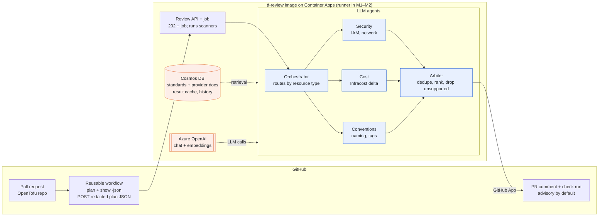
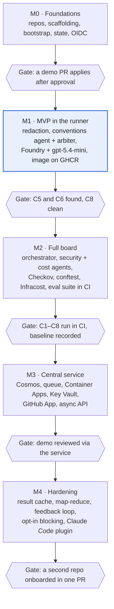

# TF PR Review Board — Plan v1

Nov 1, 2026 · @Drazsdik Gergő

## Summary

Build a multi-agent, RAG-backed review board that comments on OpenTofu (later also Terraform) pull requests, reusable by any repo through one reusable GitHub workflow, at roughly $5–30/month on Azure. Deterministic tools find issues; LLM agents explain them, rank them and tie them to the team's own standards. One container image runs the whole review: in the GitHub runner during M1–M2, in Azure Container Apps from M3.

Status: v1, every decision taken (see the Decision log); M0 is in progress. This document now lives in `tf-review/docs/plan.md` and is maintained there.

**Goals**

- Learn and showcase multi-agent orchestration, RAG and evals on a realistic DevOps problem
- A reviewer any TF repo can adopt with a few lines of workflow YAML plus a config file
- A demo template repo that shows the full setup: review, deployment, agent instructions, guardrails
- A path to production use: advisory first, blocking only on deterministic findings

**Non-goals for v1**

- Auto-fixing or auto-applying anything
- Blocking merges on an LLM opinion alone
- CI systems other than GitHub Actions, clouds other than Azure for the reviewer's own hosting
- Multi-tenant SaaS (one owner, many repos)

## Prerequisites: install before M0

Installed and verified on 2026-11-01 (setup doc step 41): OpenTofu 1.13.2, conftest 0.71.1, OPA 1.22.0, Checkov 3.4.0, Infracost CLI 2.18.3, TFLint 0.65.0, tofu-ls 0.5.3. Every install follows `~/AGENTS.md` (vscan, checksum or signature, setup-doc step, tools page, `update-sources`).

| Tool | Used for | Install | Needed from |
| --- | --- | --- | --- |
| OpenTofu (`tofu`) | Plan and apply in every repo, the bootstrap | Standalone zip, cosign verified (Fedora ships 1.11.5); repos pin `required_version = "~> 1.13"` | M0 |
| conftest | Runs the `tf-standards` Rego against plan JSON, and their unit tests with `conftest verify` (same bundled OPA that enforces them) | Release binary, SLSA attestation | M1 |
| OPA (`opa`) | `opa fmt` and `opa check` for the Rego only | Release binary, release attestation | M1 |
| Checkov | Security scanner on plan JSON (D10) | `uv tool install checkov` | M2 |
| Infracost CLI v2 | Cost of each plan with `infracost scan` on the plan JSON; JSON output for the cost agent | Release binary from `infracost/cli`, verified; plugins pinned by checksum in `INFRACOST_CLI_PLUGIN_DIR`, which also stops the CLI fetching them | M2 |
| TFLint + azurerm ruleset | Provider-aware lint in the pre-commit hook | Release binary, SLSA attestation; ruleset fetched by `tflint --init` | M0, optional |
| tofu-ls | OpenTofu language server for Neovim and the `dg-lsp` plugin Source build at a pinned tag (`go mod download` + `go build`, because `go install` rejects its `replace` directive), checked against Go's checksum database | Optional |

Already installed and used as-is: `just`, `gh`, `lefthook`, `pass`, `az`, .NET SDK 10 with TUnit templates and `csharpier`, `podman`, `actionlint`, `pinact`, `yamllint`/`yamlfmt`, `shellcheck`, `hadolint`, `gitleaks`, `cosign`/`syft`/`grype`, `jq`/`yq`, `ijhttp`, Claude Code. Terraform stays installed for the D1 Terraform input in M2.

**Accounts and one-off setup**

- [x] Convert the Azure trial to Pay-As-You-Go, then check Azure OpenAI quota in Germany West Central
- [x] Delete the resource group the Foundry portal auto-created in Sweden Central
- [ ] Before M2: request quota for a stronger model (gpt-5.4 or gpt-5.5, Data Zone Standard)
- [x] Infracost v2: create a personal access token, store it as `pass insert tf-review/infracost/cli-token`, clear any cached `infracost auth login` session
- [ ] M3: create the GitHub App and store its private key as `pass insert -m tf-review/github-app/private-key`

## Decision log

All 18 decisions are settled as of 2026-11-01. Changing one means editing its row and the sections it affects in the same commit.

| # | Decision | Choice | Why |
| --- | --- | --- | --- |
| D1 | IaC tool | OpenTofu 1.13 first; Terraform via a `tool` workflow input in M2 | Native state encryption; Terraform support doubles the test matrix, so it waits |
| D2 | Agent runtime | C# on .NET 10, Microsoft Agent Framework, `IChatClient` from Microsoft.Extensions.AI | Strongest stack; the provider stays swappable |
| D3 | Where the review runs | One container image: the workflow runs it in M1–M2, Container Apps runs it from M3 | Identical binaries and tool versions locally, in CI and in Azure |
| D4 | LLM | Azure OpenAI in Foundry, Data Zone Standard (EU): gpt-5.4-mini for every agent; gpt-5.4 or gpt-5.5 requested for security and arbiter before M2; model set per agent in config | Quota checked 2026-10-31; EU processing from day one |
| D5 | Retrieval | Metadata filter plus whole docs in M1–M2; Cosmos DB free tier with vectors in M3 | The baseline shows whether vectors actually help |
| D6 | Repo visibility | Public | Free Actions minutes and environment approvals; portfolio value |
| D7 | Repos | `tf-review`, `tf-review-demo`, `tf-standards` (created 2026-11-01) | Standards have their own owner and lifecycle in production |
| D8 | Azure region | Germany West Central for all resources | Has every service; model quota is pooled per subscription anyway |
| D9 | Gate mode | Advisory; opt-in blocking only on deterministic high findings | No merge is ever blocked by an LLM opinion alone |
| D10 | Scanners | Checkov, conftest (tf-standards Rego), Infracost CLI v2, all inside the review image | Trivy was compromised in March 2026 (CVE-2026-33634); versions pinned in one place |
| D11 | PR identity | `GITHUB_TOKEN` in M1–M2, GitHub App from M3 | The App is only needed once a service posts |
| D12 | State bootstrap | OpenTofu with local state, then `tofu init -migrate-state` | Everything stays in code |
| D13 | Subscriptions | One Pay-As-You-Go subscription, a resource group per project | Cosmos free tier is one account per subscription |
| D14 | License | Apache-2.0 | Patent grant if companies adopt it |
| D15 | Budget | €30/month, alerts at 50/80/100% | Catches runaway token spend early |
| D16 | Hosting | Azure Container Apps, consumption-only: API app + event-driven job, scale to zero | An App Service B1 plan costs $12.41/month idle (priced with Infracost on 2026-11-01) and has no job model |
| D17 | Image registry | GitHub Container Registry, public image, cosign-signed, consumers pin by digest | Free for public images; no registry bill in Azure |
| D18 | Infracost | CLI v2 with checksum-pinned plugins; token in pass locally, in Key Vault for the service | v0.10 is being retired; plugins are unsigned, so they're pinned |

## Architecture



Only the arbiter talks back to GitHub, and only findings that carry evidence (a plan pointer or an accepted doc ID) survive it. The consumer workflow does the one step that needs cloud credentials, `tofu plan`; everything after it runs from the `tf-review` container image, so scanners, agents and their versions are identical on your machine, in CI and in Azure.

**Review container image** (`ghcr.io/gergodrazsdik/tf-review`)

| Component | Pinned by | Why it's in the image |
| --- | --- | --- |
| `tfreview` CLI, API and worker (.NET 10, one build) | Git tag | The review itself; the entry command decides the role |
| Checkov | uv lockfile, installed into a venv | Security findings on the plan JSON |
| conftest (bundled OPA) | Version + checksum | Runs the `tf-standards` Rego |
| Infracost CLI v2 + terraform-plan and azure plugins | Version + checksums; `INFRACOST_CLI_PLUGIN_DIR` set in the image | Cost per resource; nothing downloads at run time |

Not in the image: OpenTofu (the plan runs in the consumer workflow, next to its credentials and state), the Azure CLI, git, and the `tf-standards` content, which is fetched at review time at the commit named in `.tf-review.yml` so a policy change never needs an image rebuild.

- Base: `mcr.microsoft.com/dotnet/aspnet:10.0` plus Python for Checkov; non-root user, read-only root filesystem
- Built by `tf-review` CI on each `v*` tag: hadolint, build, Syft SBOM, Grype scan (fails on high), cosign keyless signing with the workflow's OIDC identity (public Rekor entry, intended for a public repo), push by digest
- Consumers reference the image by digest and run `cosign verify` against `tf-review`'s release workflow identity before using it
- Locally: `just image` builds it with podman; `just review plan.json` runs it
- Size (a few hundred MB with Python and plugins) doesn't matter: the review is asynchronous

**Request flow (from M3)**

1. Consumer workflow: `tofu plan`, `tofu show -json`, then the image's `submit` command redacts the plan and POSTs it to `/reviews` with the workflow's GitHub OIDC token; the API answers `202` with a review ID
2. The API checks the token against the onboarded repos, stores the redacted plan in Blob Storage (deleted after 7 days) and enqueues a message on a Storage queue
3. A Container Apps job, scaled by that queue, picks the message up
4. The job condenses and canonicalizes the plan, runs Checkov, conftest and Infracost, then the orchestrator, the specialist agents and the arbiter
5. The GitHub App updates the PR's sticky comment and sets the `tf-review` check run

In M1–M2 steps 1–3 collapse into one: the workflow runs `tfreview review plan.json` from the same image and posts with `GITHUB_TOKEN`.

## Agents and prompts

Five LLM roles, each a Microsoft Agent Framework agent with a versioned prompt file, structured JSON output against the finding schema, and its model set in config.

| Agent | Gets | Retrieves | Model (v1) | Returns |
| --- | --- | --- | --- | --- |
| Orchestrator | Condensed diff: addresses, types, actions | Nothing | gpt-5.4-mini | Resource-to-agent routing, skipped agents, risk order (deletes, replacements, IAM, network first) |
| Security | Its slice plus the Checkov and conftest results for it | Accepted policies and ADRs whose `applies_to` matches the slice | Stronger model once granted; gpt-5.4-mini until then | Findings |
| Cost | Its slice plus Infracost per-resource cost and delta | ADRs tagged as cost guidance | gpt-5.4-mini | Findings with monthly delta |
| Conventions | Its slice plus conftest naming and tag results | ADRs and policies on naming, tags, modules | gpt-5.4-mini | Findings |
| Arbiter | All surviving findings plus the condensed diff | Nothing | Stronger model once granted; gpt-5.4-mini until then | Ranked, deduplicated findings and a verdict |

**Rules every agent run follows**

- Prompts live in `tf-review/prompts/<agent>.md` with a version header; the version is logged per call and is part of the result-cache key
- Invalid JSON gets one retry; after that, the agent's slice is reported as "not reviewed" instead of guessed
- A deterministic evidence check runs before the arbiter: each finding must point at a plan path that exists in the diff, or at a doc ID whose status is accepted; failures are dropped and counted
- Deduplication key: resource address plus rule (doc ID or scanner rule ID); the highest severity wins and the evidence is merged
- Only deterministic high findings (Checkov, conftest) can block, and only when a repo opts in (D9); LLM-only findings never block
- Agents never see secrets: redaction happens before the plan is loaded, and the image holds no credentials beyond its own managed identity

## Review service internals

One .NET 10 solution produces the CLI, the API and the worker from shared libraries, so the M3 move changes hosting, not logic.

```
src/
  TfReview.Core/       plan parsing, diff condensing, canonical JSON, redaction
  TfReview.Scanners/   Checkov, conftest and Infracost runners + result parsers
  TfReview.Rag/        IRetriever: FileRetriever (M1-M2), CosmosRetriever (M3)
  TfReview.Agents/     orchestrator, agents, arbiter, prompt loader
  TfReview.GitHub/     sticky comment + check run publishers (token or App)
  TfReview.Cli/        tfreview review | submit (runner, local, job)
  TfReview.Api/        POST /reviews, GET /reviews/{id} (M3)
  TfReview.Worker/     queue-driven review job (M3)
tests/                 TUnit projects; fixtures from the seeded demo cases
prompts/               versioned agent prompts
Containerfile
```

- **Auth**: `DefaultAzureCredential` everywhere: `az login` locally, OIDC in CI, managed identity in Azure; key auth disabled on Foundry and Cosmos
- **Config**: `appsettings.json` and environment for the service; `.tf-review.yml` per repo for enabled agents, thresholds, gate mode and the `tf-standards` commit
- **Observability**: OpenTelemetry traces and metrics to App Insights: tokens, cached tokens, latency and cost per agent call, findings per agent, evidence-check drops
- **PR output**: one sticky comment per PR (hidden marker), rewritten on each push: verdict line, monthly cost delta, a table by severity, collapsible details per resource with links to the cited `tf-standards` docs at the pinned commit
- **Check run** `tf-review`: neutral in advisory mode, failure only for opted-in blocking findings; a failed review reports itself with a link to the logs and never blocks in advisory mode

## Repositories

Three public repos under `gergodrazsdik`, developed side by side; the reviewer owns every contract the other two depend on.

| Repo | Role | Key contents |
| --- | --- | --- |
| `tf-review` | The product: reviewer service, agents, reusable workflow, its own infra | `src/`, `action/`, `.github/workflows/tf-review.yml`, `infra/`, `bootstrap/`, `test/fixtures/`, `plugin/` |
| `tf-review-demo` | GitHub template repo for any TF project adopting the reviewer | Sample TF, `.tf-review.yml`, plan/apply workflows, `docs/adr/`, seeded bad-PR branches |
| `tf-standards` | Org standards corpus for RAG and policy enforcement | ADRs, policies (Markdown + Rego side by side), design docs, indexing workflow |

```
tf-review/
  bootstrap/          # state storage, identities, onboarding map, budget
  infra/              # Foundry (M1); Cosmos, queue, Container Apps, Key Vault (M3)
  src/                # .NET 10 solution: CLI, API, worker
  tests/              # TUnit projects; tests/fixtures: plan JSON + expected findings
  prompts/            # versioned agent prompts
  action/             # composite action: plan, verify image, review or submit
  plugin/             # Claude Code plugin: conventions skill + hooks (M4)
  docs/               # plan.md, contracts/ (JSON Schemas)
  Containerfile
  .github/workflows/
    tf-review.yml     # on: workflow_call
    ci.yml            # lint, test, e2e
    release.yml       # image build, scan, sign, push on v* tags
```

**Contracts owned by `tf-review`** (versioned with tags, JSON Schema where possible)

1. Reusable workflow inputs and outputs (`tool`, `working-directory`, `config-path`, `mode`)
2. `.tf-review.yml` schema: enabled agents, severity thresholds, gate mode, standards source
3. Finding schema: resource address, severity, evidence (plan pointer or doc ID), suggestion, agent
4. Corpus frontmatter schema: `id`, `type`, `status`, `superseded_by`, `applies_to`, `severity`, `rego`

During tandem development the demo repo calls the workflow at a feature branch (`@feat/x`) and repins to a tag after merge.

## Setup: repos, folders and dev workflow

All three repos sit side by side under `~/projects/tf-review-board/`; each gets a `justfile` and a `lefthook.yml`, and every secret comes from pass at run time.

**Create the repos (M0; `gh` writes, so you run them)**

```bash
mkdir -p ~/projects/tf-review-board && cd ~/projects/tf-review-board
gh repo create gergodrazsdik/tf-review --public --clone --add-readme \
  --license apache-2.0 \
  --description "Multi-agent RAG review board for OpenTofu PRs"
gh repo create gergodrazsdik/tf-review-demo --public --clone \
  --add-readme --license apache-2.0 --gitignore Terraform \
  --description "Template: OpenTofu project reviewed by tf-review"
gh repo create gergodrazsdik/tf-standards --public --clone \
  --add-readme --license apache-2.0 \
  --description "Template: ADRs and policies for tf-review"
gh repo edit gergodrazsdik/tf-review-demo --template
gh repo edit gergodrazsdik/tf-standards --template
```

`tf-review` gets its `.gitignore` from `dotnet new gitignore` plus the OpenTofu patterns (`.terraform/`, `*.tfplan`, `*.tfstate*`).

**Repo settings (each repo)**

1. Workflow token read-only by default: `gh api -X PUT repos/gergodrazsdik/<repo>/actions/permissions/workflow -f default_workflow_permissions=read`
2. Settings → Actions: require approval for workflow runs from all outside contributors
3. Ruleset on `main` kept in the repo as `.github/rulesets/main.json` (PR required, squash merges only, signed commits, required check `lint`, plus `plan` in `tf-review-demo`, the only repo with a plan job in M0), applied with `gh api repos/gergodrazsdik/<repo>/rulesets --input .github/rulesets/main.json`
4. `tf-review-demo` only: environment `prod` with you as required reviewer

**justfile recipes** (`just` lists them; destructive ones carry `[confirm]`). Each recipe arrives with the milestone that first needs it: M0 has `claude`, `hooks`, `lint`, `contracts`, `bootstrap-*` and `policy-test`; `test`, `plan`, `cost`, `review`, `e2e` and `secrets-sync` come with M1 and M2.

| Recipe | Repo | Does |
| --- | --- | --- |
| `just claude` | all | Starts Claude Code with the two sibling repos added and their CLAUDE.md loaded |
| `just hooks` | all | `lefthook install` |
| `just lint` | all | The pre-commit checks on every file; the CI `lint` job runs the same recipe |
| `just test` | `tf-review` | `dotnet test` (TUnit) |
| `just plan <dir>` | `tf-review`, `tf-review-demo` | `tofu init`, `plan -out`, `show -json`, then canonicalize and redact |
| `just cost <plan.json>` | `tf-review`, `tf-review-demo` | `infracost scan <plan.json> --json` with the token read from pass for that run only and `SSH_AUTH_SOCK` unset |
| `just review <plan.json>` | `tf-review` | Runs the reviewer console app locally on one plan |
| `just e2e` | `tf-review` | Plans the demo fixtures, reviews them, asserts the expected findings; the Claude Code Stop hook runs it |
| `just bootstrap-plan` / `bootstrap-apply` / `bootstrap-migrate` | `tf-review` | The bootstrap project with your `az login`; apply and migrate ask first |
| `just secrets-sync` | `tf-review` | Copies pass entries into Actions secrets and Key Vault; you run it, never an agent |
| `just policy-test` | `tf-standards` | `opa fmt --fail`, `conftest verify`, frontmatter schema check |

The `claude` recipe in `tf-review` (the other repos list their own two siblings):

```just
# Start Claude Code with the demo and standards repos in reach
[group('dev')]
claude *args:
    CLAUDE_CODE_ADDITIONAL_DIRECTORIES_CLAUDE_MD=1 claude \
      --add-dir ../tf-review-demo --add-dir ../tf-standards {{args}}
```

**lefthook.yml** (pre-commit runs in parallel on staged files; pre-push runs `just test` or `just policy-test`)

| Hook | Files | Command |
| --- | --- | --- |
| tofu fmt | `*.tf` | `tofu fmt -check {staged_files}` |
| tflint | `*.tf` | `tflint --recursive` |
| yamllint | `*.yml`, `*.yaml` | `yamllint {staged_files}` |
| actionlint, pinact | `.github/workflows/*` | `actionlint` and `pinact run --check` |
| shellcheck | `*.sh` | `shellcheck {staged_files}` |
| hadolint | `Containerfile` | `hadolint {staged_files}` |
| dotnet format | `*.cs` | `dotnet format --verify-no-changes --include {staged_files}` |
| opa fmt | `*.rego` | `opa fmt --fail {staged_files}` |
| gitleaks | everything staged | `gitleaks git --pre-commit --staged` |

**Secrets in pass** (never in a repo, `.env` file or shell config)

| pass entry | Used locally by | Reaches CI or Azure via |
| --- | --- | --- |
| `tf-review/infracost/cli-token` | `just cost` runs, exported as `INFRACOST_CLI_AUTHENTICATION_TOKEN` | M1–M2: `just secrets-sync` → Actions secret per onboarded repo; M3: Key Vault, repo secrets removed |
| `tf-review/github/bootstrap-token` | `just bootstrap-*` (github provider: Actions variables, `prod` environment) | Never leaves the machine |
| `tf-review/github-app/private-key` (M3) | Local runs of the review service | `just secrets-sync` → Key Vault |

Azure needs no keys at all: Azure OpenAI and Cosmos DB use Entra ID (`az login` locally, OIDC in CI, managed identity in Azure) with local key auth disabled on both. Recipes read pass entries only at run time, so pinentry may prompt.

## Infrastructure and state

One storage account holds every repo's state, created once by a bootstrap project run from your laptop; everything after that deploys through CI with OIDC and no stored secrets.

**Bootstrap (`tf-review/bootstrap`)**

1. Run once with local state through the bootstrap recipes (OpenTofu, your az login): resource group, storage account (versioning, soft delete, `CanNotDelete` lock), state containers, managed identities, federated credentials, role assignments.
2. Add the `azurerm` backend (`use_oidc`, `use_azuread_auth`) and run `init -migrate-state` so bootstrap's own state moves into the account.
3. Onboard repos through a `repos` map: each entry creates a container, a plan identity and an apply identity, and sets the repo's Actions variables via the `github` provider.
4. Later, give bootstrap its own CI identity so onboarding becomes a reviewed PR.

**Identities per repo**

| Identity | Federated subject | Rights |
| --- | --- | --- |
| Plan | `repo:<owner>/<repo>:pull_request` | Reader on the target scope, Blob Data Contributor on its own state container |
| Apply | `repo:<owner>/<repo>:environment:prod` | Write on the target scope, gated by environment approval |
| Reviewer submit (M3) | Customised subject incl. `job_workflow_ref` | Call the review API only |

**Reviewer infrastructure** (`tf-review/infra`; Foundry from M1, the rest from M3)

| Resource | Purpose | Tier | From |
| --- | --- | --- | --- |
| Azure OpenAI in Foundry | gpt-5.4-mini Data Zone deployment; later the stronger model and `text-embedding-3-small` | Pay-as-you-go, key auth disabled | M1 |
| Role assignments | Cognitive Services OpenAI User for each onboarded repo's plan identity (M1–M2) and the service identity (M3) | — | M1 |
| Cosmos DB for NoSQL | Vectors, review history, result cache, feedback | Free tier (1,000 RU/s, 25 GB), key auth disabled | M3 |
| Storage account | Review queue and redacted plans (lifecycle rule deletes after 7 days) | Standard LRS | M3 |
| Container Apps | Review API (scale to zero) and the queue-scaled review job | Consumption-only environment, public ingress | M3 |
| Key Vault | GitHub App private key, Infracost token | Standard, RBAC | M3 |
| App Insights + Log Analytics | Traces, tokens, cache hit rate | Daily ingestion cap | M3 |

All resources live in Germany West Central (D8). Model deployments use Data Zone Standard (EU) from day one (D4); gpt-5.4-mini has 200K TPM there and no Global Standard quota (checked 2026-11-01).

## RAG, context and caching

Retrieval filters on metadata first and uses vectors second; every prompt is cut to a diff and a fixed token budget before any model sees it.

**Corpus**

- Global scope: `tf-standards` (ADRs, policies with their Rego, design docs) and provider docs keyed by `provider@version` from each repo's lock file
- Repo scope: each TF repo's own `docs/adr/`, indexed by that repo's CI with `scope: repo`
- Only `status: accepted` docs are retrievable; superseded ones are excluded, so agents never cite a retired decision

**Indexing (GitHub Action on push to `main`)**

1. Diff changed Markdown files
2. Chunk by heading; hash each chunk
3. Embed only new or changed chunks; delete chunks of removed files
4. Upsert to Cosmos with frontmatter as filter fields and the commit SHA as `corpus_version`

**Retrieval per agent**

1. Filter by `applies_to` (resource types in the agent's slice), `status` and `scope`
2. M1–M2: include whole matching docs; M3: vector or hybrid ranking within the filtered set
3. Stop at a per-agent token cap, deduplicated by doc ID

**Context budget**

- Send `resource_changes` only, drop `no-op` entries, keep only attributes that differ between `before` and `after`
- Each agent gets only its routed resources plus their scanner findings
- Above a size threshold, batch resources across calls (map-reduce) and review deletes, replacements, IAM and network changes first; the comment states what was skipped

**Caching**

- Prompt layout, most static first: common preamble → condensed diff → agent instructions → retrieved chunks → scanner findings
- The orchestrator runs first and warms the cache; the specialist agents then run in parallel
- Canonical JSON, deterministic redaction placeholders, chunks sorted by doc ID, no timestamps or IDs in the prefix
- Result cache in Cosmos keyed on `hash(resource change + agent + prompt version + corpus_version)`; unchanged resources are skipped on re-push
- Log `cached_tokens` per agent call to App Insights

## CI/CD and GitHub

A consumer repo adopts the reviewer with one `uses:` line; plan runs on every PR, apply runs on merge behind an environment approval, and no secret is stored anywhere.

**Reusable workflow `tf-review.yml` (PR path)**

1. `azure/login` via OIDC with the repo's plan identity
2. `setup-opentofu` at the version in `.tf-review.yml` (or Terraform per D1); provider cache keyed on `.terraform.lock.hcl`; `init -lockfile=readonly`
3. `plan -out`, then `show -json`
4. Pull the review image by digest and `cosign verify` it against `tf-review`'s release workflow identity
5. M1–M2: run `tfreview review plan.json` from the image (redaction, Checkov, conftest, Infracost, agents) and post the sticky comment with `GITHUB_TOKEN`; the plan identity holds Cognitive Services OpenAI User on the Foundry resource
6. M3: run `tfreview submit plan.json` instead; the API answers `202`, and the GitHub App posts the comment and the check run

**Apply path (consumer workflow)**

- Trigger on merge to `main`; job uses environment `prod` with you as required reviewer
- Re-plan and apply, or apply the reviewed plan file if state is unchanged (Terraform refuses a stale plan)
- `concurrency` group per state key, `cancel-in-progress: false`

**Repo settings (public repos)**

- Third-party actions pinned to full commit SHAs with `pinact`; a `lint` job runs `actionlint` and `just lint`
- Require approval for workflow runs from outside collaborators; never `pull_request_target`
- No plan files as artifacts; mark sensitive variables `sensitive` so logs stay clean
- Rulesets from `.github/rulesets/main.json` (see Setup); the review check stays advisory until M4
- `tf-review-demo` and `tf-standards` are template repositories
- Repos are public, so other repos call `tf-review`'s reusable workflow without extra access settings
- Infracost: in M1–M2 the token reaches each onboarded repo as the `INFRACOST_CLI_AUTHENTICATION_TOKEN` secret via `just secrets-sync`; from M3 only the service holds it (Key Vault) and the repo secrets are removed. Plugins are baked into the image, so nothing downloads at run time

## Milestones



M1 is deliberately thin: one agent and one Azure resource (Foundry with gpt-5.4-mini), so the first real PR comment lands early and every later milestone has an eval baseline to beat. A milestone is done when its gate passes on a real PR, not when its tasks are ticked.

**M0 · Foundations** (in progress)

- [x] Prerequisite tools installed and verified (setup doc step 41)
- [x] Three repos created; demo and standards marked as templates
- [x] Scaffold all three repos: justfile, lefthook, CLAUDE.md, `.claude/` settings, lint workflow, ruleset JSON
- [x] `tf-review/docs/contracts/`: JSON Schemas for `.tf-review.yml`, findings, corpus frontmatter
- [x] `tf-standards`: ADR-001 naming, ADR-002 required tags, POL-001 storage, with Rego and `conftest verify` tests
- [ ] Bootstrap: state storage, identities, GitHub variables and `prod` environment, budget; apply, then migrate state
- [ ] Rulesets applied; fork-PR approval set in each repo
- [ ] Gate: a demo PR plans, comments, and applies after approval

Open items from the M0 scaffold:

- [ ] Turn on the Claude Code sandbox in each repo: from a home-dir session add `tofu *` and `just bootstrap-*` to `excludedCommands` in user settings, because a sandboxed `tofu plan` can't read `~/.azure`; then set `.claude/settings.local.json` in each repo. The scaffold task above is ticked without this
- [ ] From a home-dir session, add a `tofu fmt` branch for `.tf` files to `claude-lint-hook`; until then the hook uses `terraform fmt`, while lefthook and CI use `tofu fmt`
- [ ] Confirm the subscription's billing currency is EUR before `just bootstrap-apply`: the budget's 30 is in that currency (D15)
- [ ] Add more platforms to `bootstrap/.terraform.lock.hcl` (`tofu providers lock`) if bootstrap ever runs off `linux_amd64`
- [ ] Align `pinact`: CI pins 5.0.2, the local install is 5.0.0

**M1 · MVP in the runner**

- [ ] `TfReview.Core`: condense, canonicalize, redact, with a redaction fixture full of fake secrets
- [ ] `infra/` v0: Foundry resource (key auth off), gpt-5.4-mini Data Zone deployment, role for the demo's plan identity
- [ ] `Containerfile` and `just image`; `release.yml` builds, scans, signs and pushes to GHCR
- [ ] Reusable workflow v0: plan, verify image, `tfreview review`, sticky comment
- [ ] Conventions agent and arbiter; `FileRetriever` over `tf-standards` at a pinned commit; evidence check
- [ ] Seeded cases C5, C6, C8 as branches in `tf-review-demo`; their plan fixtures in `tf-review`
- [ ] `just e2e` and the Claude Code Stop hook
- [ ] Gate: C5 and C6 found with citations, C8 stays clean

**M2 · Full board**

- [ ] One-day spike: cost delta via Infracost v2's diff against a main-branch baseline vs pricing `prior_state` ourselves; decide on case C4
- [ ] Orchestrator, security and cost agents; Checkov, conftest and Infracost inside the image
- [ ] Dedupe and severity rules in code; structured output enforced
- [ ] Prompt-cache layout; `cached_tokens` logged per call
- [ ] Seeded cases C1–C4 and C7; eval suite in CI with the baseline recorded
- [ ] Stronger model deployed if quota is granted; models set per agent
- [ ] Terraform support through the `tool` input (D1)
- [ ] Gate: C1–C8 run in CI, baseline recorded

**M3 · Central service**

- [ ] `infra/`: Cosmos (free tier, vectors), Storage queue and blob, Container Apps environment, API and job, Key Vault, App Insights, embedding deployment
- [ ] GitHub App; private key in pass and Key Vault
- [ ] API and worker; the workflow switches to `tfreview submit` and `202`
- [ ] `tf-standards` indexing workflow; `CosmosRetriever`; vectors compared with the metadata baseline on the eval suite
- [ ] Infracost token moved to Key Vault; repo secrets removed
- [ ] Gate: a demo PR reviewed through the service, asynchronously

**M4 · Hardening**

- [ ] Result cache keyed on resource change, agent, prompt version and corpus version
- [ ] Map-reduce for large PRs with risk-first ordering
- [ ] Feedback from comment reactions turned into eval cases
- [ ] Opt-in blocking on deterministic high findings
- [ ] Self-review on `tf-review` with the advisory exception
- [ ] Claude Code plugin with the conventions skill and hooks
- [ ] Gate: a second repo onboarded with one bootstrap map entry and the template

**Backlog after v1**

- Terraform Cloud / HCP-hosted plans as an input
- AWS and Google pricing (add their Infracost plugins to the image)
- Fix suggestions as GitHub suggested changes
- OpenTofu state encryption with a key held in Key Vault
- Self-hosted Infracost pricing, which also switches off its telemetry, before any client repo is onboarded

## Evaluation

A catalogue of seeded bad changes in `tf-review-demo` is both the template's teaching material and the eval suite; every prompt or retrieval change runs against it in CI before merge.

**Seeded cases (starting set)**

| Case | Change | Expected finding | Agent |
| --- | --- | --- | --- |
| C1 | NSG rule allows `0.0.0.0/0` on 22 | High: public SSH, cites the network policy | Security |
| C2 | Storage account with public blob access | High: cites `POL-012`-style policy | Security |
| C3 | Role assignment `Owner` at subscription scope | High: over-privileged identity | Security |
| C4 | VM or App Service plan SKU jumps two sizes | Medium: monthly cost delta from Infracost | Cost |
| C5 | Resource missing required tags | Medium: cites the tagging ADR | Conventions |
| C6 | Resource name breaks the naming convention | Low: cites the naming ADR | Conventions |
| C7 | Change forces replacement of a database | High: destructive change flagged first | Orchestrator + arbiter |
| C8 | Clean change (tag value update) | No findings | All |

**Metrics tracked per run**

- Recall per agent on C1–C7; false-positive count on C8
- Share of findings with valid evidence (plan pointer or accepted doc ID)
- Tokens, cost and latency per PR; cache hit rate per agent
- M3 only: vector retrieval vs metadata-only baseline on the same cases

**Feedback loop (M4)**: reviewers mark findings accepted or dismissed via comment reactions; dismissed findings become new negative eval cases.

## Costs and risks

Expected spend is about $5–30/month at roughly 100 PRs, almost all of it LLM tokens; GitHub costs nothing with public repos. Figures are estimates from list prices, to be replaced by measured cost per PR in M2.

| Item | Monthly estimate | Basis |
| --- | --- | --- |
| GitHub (Free, public repos) | $0 | Unlimited Actions minutes, environment approvals, GHCR for the public image |
| LLM tokens | \~$5–25 | \~5 calls per PR, \~15k tokens in and 2k out each; gpt-5.4-mini for most calls keeps it at the low end |
| Embeddings | Cents | `text-embedding-3-small`, changed chunks only |
| Cosmos DB | $0 | Free tier, within 1,000 RU/s and 25 GB |
| Container Apps | Near $0 | Consumption-only environment, scales to zero, no private endpoints |
| Storage (state, queue, plans) | Cents | Standard LRS, plans deleted after 7 days |
| Logs | A few $ | Daily ingestion cap |
| Infracost | $0 | Free tier; pricing runs reportedly capped around 1,000 a month |

| Risk | Mitigation |
| --- | --- |
| No model quota after PAYG conversion | Checked: Data Zone gpt-5.4-mini (200K TPM) and text-embedding-3-small are available; request a stronger model before M2 |
| Hallucinated findings | Evidence required per finding; arbiter drops unsupported ones; never blocks on LLM output alone |
| Secrets leaking via plan JSON or public logs | Redact before any LLM call; no plan artifacts; `sensitive` variables |
| Large PRs blow context and cost | Diff-only input, per-agent slices, token caps, map-reduce with risk-first ordering |
| Reviewer outage blocks its own fix PR | Advisory check on `tf-review`; deploy as Container Apps revisions with smoke test |
| Token cost creep | Budget alerts (D15), result cache, prompt caching, cost per PR on the eval dashboard |
| Container Apps fixed fee appears | Private endpoints and planned maintenance each add $0.10/hour (\~$73/month); keep public ingress with Entra/OIDC auth and leave both off |
| Infracost v2 plugins run unverified | Plugins pinned by checksum in `INFRACOST_CLI_PLUGIN_DIR` locally and in CI; no signatures exist, so this stays a known gap; CLI updates only through the setup doc, never `infracost update` |
| Infracost v2 telemetry cannot be disabled | Every scan sends command, flags, install ID, org, repo URL and branch; fine for these public repos, but for client repos either accept it, use self-hosted pricing mode, or drop the cost agent |
| Infracost free-tier run limit | The free tier reportedly counts pricing runs (about 1,000 a month); the result cache skips unchanged plans |
| Policy tests pass but enforcement differs | Rego unit tests run in `conftest verify`, the same OPA build that enforces them; tofu, conftest and Checkov pinned to the same versions locally and in CI. Standalone `opa` runs only `opa fmt` and `opa check` and can be ahead of conftest's bundled OPA (1.22.0 vs 1.21.1 on 2026-11-01) |
| Scope creep | Milestone gates above; anything else goes to a later backlog |

**Sources**

- [Azure Cosmos DB free tier](https://learn.microsoft.com/azure/cosmos-db/free-tier)
- [GitHub: managing environments for deployment](https://docs.github.com/actions/managing-workflow-runs-and-deployments/managing-deployments/managing-environments-for-deployment)
- [GitHub Actions billing](https://docs.github.com/billing/managing-billing-for-your-products/managing-billing-for-github-actions)
- [Azure OpenAI quota on trial vs PAYG (Microsoft Q&A)](https://learn.microsoft.com/en-us/answers/a/12804121)
- [Azure OpenAI pricing overview](https://www.opslyft.com/blog/azure-openai-pricing)

* [Region availability for Foundry Models sold by Azure](https://learn.microsoft.com/en-us/azure/foundry/foundry-models/concepts/models-sold-directly-by-azure-region-availability)
* [Container Apps management charge for private endpoints (GitHub issue)](https://github.com/microsoft/azure-container-apps/issues/1596)
* [Container Apps adds Austria East (August 2026 update)](https://github.com/microsoft/azure-container-apps/issues/1834)

- [Trivy ecosystem supply chain compromise, CVE-2026-33634 (OSV)](https://osv.dev/vulnerability/CVE-2026-33634)
- [OpenTofu standalone install and verification](https://opentofu.org/docs/intro/install/standalone/)

* [Infracost CLI v2 commands and CI token](https://www.infracost.io/docs/features/cli_commands/)
* [Infracost: cost a plan JSON with CLI v2](https://www.infracost.io/resources/blog/terraform-plan-output-support-cli-v2)

## Working with Claude Code

Start every session with `just claude` in the repo the task is mainly about; it adds the two siblings, and `just e2e` gates every cross-repo change.

```bash
cd ~/projects/tf-review-board/tf-review
just claude
```

This plan is `tf-review/docs/plan.md`. Sessions update it in the same PR whenever a decision, contract or milestone changes, and tick milestone tasks as they land.

- **CLAUDE.md per repo**: purpose, which `just` recipes to run (`lint`, `test`, `plan`, `e2e`), pointer to the contracts; kept short
- **`.claude/rules/` with path globs**: OpenTofu conventions for `**/*.tf`, C# for `src/**`, Rego for `**/*.rego`
- **Sandbox on per repo** via `.claude/settings.local.json`, as in your other projects; `tofu init` needs `registry.opentofu.org`, so either allowlist it or add `tofu` to `excludedCommands` in user settings (project settings can't add exclusions)
- **Stop hook in `tf-review`** runs `just e2e`
- **`permissions.deny`**: `tofu apply`, `terraform apply`, `tofu state rm`, `az * delete`; Claude plans, CI applies, and `just bootstrap-apply` and `just secrets-sync` stay yours
- **Lint hook**: `claude-lint-hook` already runs `terraform fmt`; add a `tofu fmt` branch for `.tf` files so the agent and lefthook agree
- **Plan mode** for changes spanning two repos; the plan file survives compaction
- **Worktrees** for parallel sessions (`gwt` to switch), e.g. agent prompts in one, demo fixtures in another
- **`plugin/` in `tf-review`**: the OpenTofu conventions skill and hooks packaged so consumer repos get the same guardrails locally (M4)

